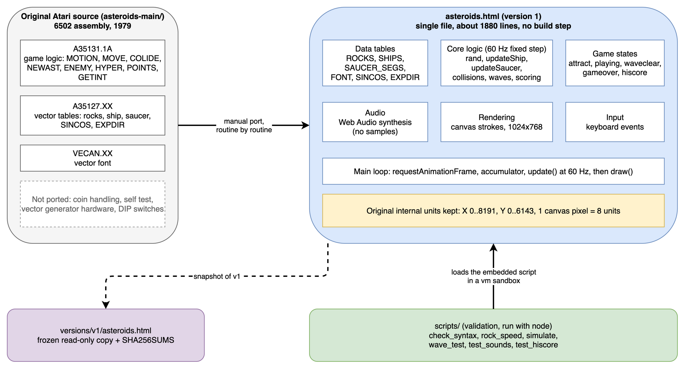
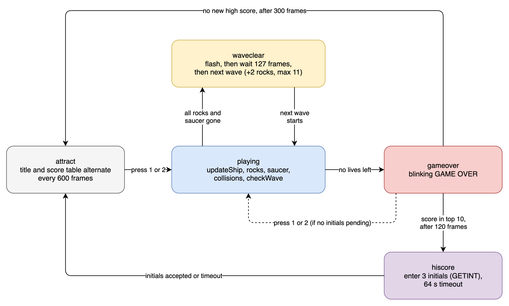
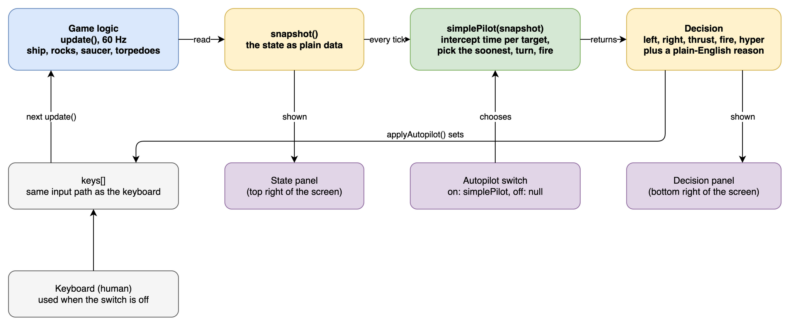

# Architecture

[`asteroids.html`](../asteroids.html) is one self-contained file: HTML shell, one inline `<script>`, no dependencies, no build step. This document describes how that script is organized and how it maps back to the original 6502 source in [`asteroids-main/`](https://github.com/historicalsource/asteroids). The sections up to "Game states" describe version 1 and still apply. [Version 2](#version-2-additions) adds the screen layout, the state snapshot and the autopilot. [Version 3](#version-3-additions) adds a second autopilot and the controller selector.

Editable diagram sources are in [`docs/diagrams/`](diagrams/) (`.drawio`, exported to `.png`).

## Overview (version 1)

Source file: [`diagrams/v1-architecture.drawio`](diagrams/v1-architecture.drawio).

## Layout of the script

Line numbers refer to version 2 (frozen in `versions/v2/`, identical to the working copy at the start of version 3) and are approximate section boundaries. The file has 2,218 lines. Version 1 had 1,880.

| Lines | Section | Contents |
|-------|---------|----------|
| 7-98 | HTML shell | CSS and markup for the monitor, the State panel, the Decision panel and the Autopilot switch |
| 100-162 | Constants | Coordinate system, velocity limits, torpedo life, collision thresholds, each annotated with the original opcode it came from |
| 164-233 | Math and RNG | `SINCOS` table, `atanOrig` (the original `ATAN` routine, new in version 2), `sinA`/`cosA`, `rand()` (bit-exact LFSR) |
| 235-358 | Vector data | `ROCKS`, 17 `SHIPS` frames, `SHIP17`, `SAUCER_SEGS`, `EXPDIR`, vector `FONT` |
| 360-460 | Canvas helpers | `resize` (fits the 4:3 canvas beside the side column), `drawSegs`, `drawShipFrame`, `drawText` |
| 461-511 | Game state | State variables, players, scores, high score table, timers, `gdelay` |
| 512-848 | Audio | Web Audio synthesis of every arcade sound effect |
| 849-1002 | Object factories and setup | `makeShip`, `makeRock`, `makeTorp`, `makeSaucer`, `newVelComp`, `initGame`, per-player save/load, `startWave` |
| 1003-1376 | Ship and rocks | `spawnRock`, `updateShip` (rotate, thrust, friction, respawn), `fireTorpedo`, `doHyperspace`, `explodeShip`, rock and torpedo updates |
| 1378-1476 | Saucer | `updateSaucer` (entry, size choice, fire timing) |
| 1477-1584 | Collision | `collides`, `checkCollisions`, `splitAsteroid`, `explodeSaucer` |
| 1585-1667 | Score | `addScore` (extra life every 10,000), high score table, initials entry |
| 1668-1796 | Flow control | Particles, `checkWave`, `update()` |
| 1797-2011 | Drawing | HUD, attract screen, score table, initials screen, game over, `draw()` |
| 2012-2127 | State and autopilot | `snapshot`, `logState`, `applyAutopilot`, `simplePilot` |
| 2129-2178 | Demo panels | Autopilot switch handler, `stateText`, `updatePanels` |
| 2179-2218 | Loop and input | Fixed-step loop, keyboard handlers, boot |

## Main loop

`loop()` runs on `requestAnimationFrame`. An accumulator converts elapsed wall time into a whole number of fixed 16.67 ms steps, so `update()` always advances the game at 60 Hz regardless of the display refresh rate. Elapsed time is clamped to 100 ms so a background tab does not trigger a burst of catch-up steps. `draw()` and `updatePanels()` run once per animation frame. In each fixed step, `applyAutopilot()` runs first, then `update()`.

## Game states

Source file: [`diagrams/v1-game-states.drawio`](diagrams/v1-game-states.drawio).

| State | Meaning | Left when |
|-------|---------|-----------|
| `attract` | Title and score table alternate every 600 frames | Key 1 or 2 |
| `playing` | Normal gameplay | All rocks and saucer cleared, or no lives left |
| `waveclear` | Screen flash, then wait until 127 frames have passed since the last rock | Next wave starts |
| `gameover` | Blinking GAME OVER | 120 frames (initials pending), 300 frames (none), or key 1 or 2 when no initials are pending |
| `hiscore` | Three-initials entry, 64 s timeout | Initials accepted or timeout |

## Mapping to the original source

The port keeps original routine names in comments so each JS function can be traced back to a 6502 routine. Line numbers are in `asteroids-main/A35131.1A`.

| Original routine | Orig. line | JS function | Notes |
|------------------|-----------|-------------|-------|
| `RAND` | 2393 | `rand()` | Bit-exact 2-byte LFSR |
| `MOTION` | 1172 | position block of `updateShip`, `updateAsteroids`, `updateTorpedoes`, `updateSaucer` | Wrap at 0x20 horizontally and 0x18 vertically |
| `MOVE`, `MOVE2` | 1291, 1410 | `updateShip` | Rotation 3/256 per frame, thrust, friction, clamp at 0x3F |
| `NEARBY` | 1429 | respawn check in `updateShip` | Waits until no rock is within 4 high-byte units |
| `COLIDE` | 396 | `collides` | Half-distance box test with corner clipping |
| `NEWAST` | 1460 | `startWave`, `spawnRock` | +2 rocks per wave, capped at 11 |
| `NEWVEL` | 1538 | `newVelComp` | Exact, including the speed drift on splits |
| `SPLIT` | 2103 | `splitAsteroid`, `spawnRock` | Includes the anti-overlap offset |
| `ENEMY`, `EFIRE` | 640, 718 | `updateSaucer`, `fireTorpedo` | Entry timing, size selection, fire interval and aim error follow the original |
| `ATAN` | 2245 | `atanOrig` | Ported with its helper routines `ATAN1` to `ATAN3`, `DIVIDE` and `COMP`; used by the small saucer's aim |
| `CHKST1` | 321 | `checkWave` | Turn switching, `SDELAY` 0x10 after a death or a switch |
| `FIRE` | 801 | `fireTorpedo` | Velocity cap 0x6F, 4 torpedo slots |
| `HYPER` | 1023 | `doHyperspace` | Original random-call sequence and destruction check |
| `CHKST` | 215 | `checkWave` | Wave and game-over transitions |
| `POINTS` | 1756 | `addScore` | 100/50/20 for rocks, 200/1000 for saucers |
| `UPDATE` | 2157 | `registerHighScores` | Strictly greater, ties rank below |
| `GETINT` | 902 | `updateEntry` | Rotate selects letter, hyperspace accepts |
| `SCORES` | 1777 | `drawScoreTable` | Ten lines of rank, score, initials |
| `PARAMS` | 1580 | `drawHUD` | Scores, lives |
| `PICTUR` | 1669 | `drawSegs` and the per-object draw functions | Scale 1, 1/2, 1/4 |

Not ported: coin handling (`COIN65.XX`), self test (`A35131.1E`), vector generator hardware code, DIP switch options and the sound hardware registers. Sound is re-created, not translated; see [Port notes](PORT_NOTES.md).

## Design decisions worth noting

- **Original units, not pixels.** Positions stay in the original 0..8191 by 0..6143 space and are divided by 8 only when drawing. This keeps velocities, thresholds and tables identical to the source.
- **Fixed timestep.** Game speed does not depend on monitor refresh rate.
- **Single file.** Trade-off: trivially portable and diffable, but all state is module-level `let` variables and the file is not unit-testable without a `vm` sandbox. The validation scripts work around this by loading the inline script into a sandbox with stubbed `document`, `window` and canvas.
- **Session-only persistence.** The high score table lives in memory and is lost on reload.

## Version 2 additions

Source file: [`diagrams/v2-state-decision-loop.drawio`](diagrams/v2-state-decision-loop.drawio).

- **One input path.** The keyboard handler and `applyAutopilot()` both write the `keys` table. `update()` reads only `keys`, so the game logic does not know who is playing.
- **State as a copy.** `snapshot()` returns plain data. It does not hand out references to the live objects, so a controller cannot change the game except through the five keys.
- **A controller is a function.** `AUTOPILOT` is either `null` (keyboard) or a function from a snapshot to `{ left, right, thrust, fire, hyper, why }`. Replacing `simplePilot` with another function is a one-line change.
- **The UI reads, never writes.** `updatePanels()` only reads the snapshot and `keys`; the single write path from the UI is the controller selector (see version 3), which sets `AUTOPILOT` and releases the held keys.
- **Layout.** The canvas keeps its 1024x768 internal size. `resize()` scales it with CSS to fit the space left of the 420 px side column, and sets the side column to the height of the monitor.

## Version 3 additions

The line numbers in the layout table above describe version 2. Version 3 inserts about 240 lines (`smartPilot` and its helpers, after `simplePilot`) and replaces the Autopilot switch in the HTML shell and the demo panels section.

- **Controller table.** `CONTROLLERS = { manual: null, simple: simplePilot, smart: smartPilot }` maps the three selector buttons to the value of `AUTOPILOT`. `setController(name)` is the single write path from the UI. A new controller is one entry in the table and one button.
- **Forward model inside the pilot.** `smartPilot` keeps no state between ticks. It rebuilds its prediction from the snapshot: `spThreats` (straight-line movers), `spShipStep` (a copy of the movement part of `updateShip`), `spHits` (the `COLIDE` rule) and `spSimulate`. If `updateShip` or `collides` change, these copies must change with them; `check_thrust_physics.js` fails when the copy of the ship movement drifts from the game.
- **Snapshot additions.** `ship.vxf` and `ship.vyf` (fractional velocity), and `exploding` on rocks and the saucer.
- **Panel additions.** `lastHeld` records the last tick each key was held, so `updatePanels()` can keep a tapped key lit for 0.4 s and describe whether the ship is thrusting or coasting.
- **Shared test loader.** `scripts/dev/lib/load_game.js` loads the inline script headlessly for the version 3 scripts, with optional source patches to add instrumentation without touching the game file.

See [VERSION_3.md](VERSION_3.md) for what the pilot decides and how it was measured.
