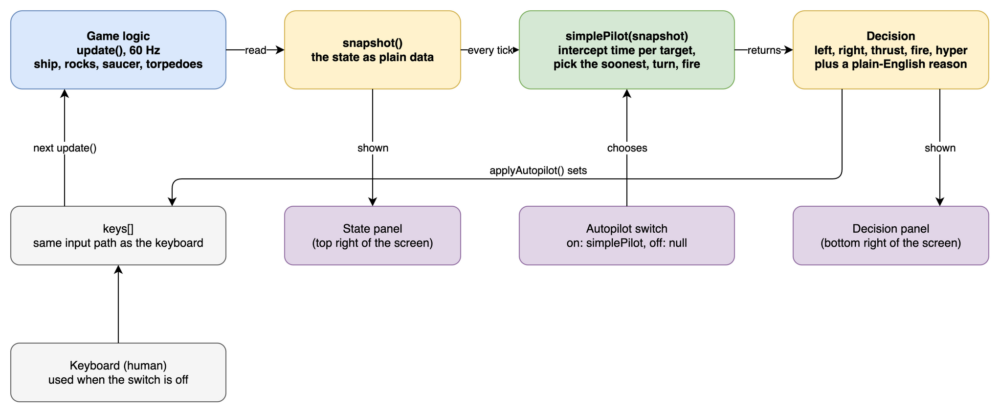

# Version 2: restored behavior, observable state, and an autopilot

Version 2 is frozen in [`versions/v2/`](../versions/v2/) (SHA-256 `dcf850dc81f418c57b90453e714d9e8c2a6e110cf24ae651e4239360031c7f42`). It started from the frozen [version 1](VERSION_1.md) and does two things:

1. It restores behavior that was lost or wrong in the first port. These are corrections to the 6502 reading, not new features.
2. It makes the game state and the player's decisions visible, and uses that to run a very simple autopilot that plays far better than a human would expect from so little logic.

The working copy, [`asteroids.html`](../asteroids.html), is now version 3 and will diverge from this file. Every statement below describes the frozen v2. See [`versions/v2/README.md`](../versions/v2/README.md) for the checksum and verification commands.

- Fidelity notes, controls, sound: [PORT_NOTES.md](PORT_NOTES.md)
- Structure and routine mapping: [ARCHITECTURE.md](ARCHITECTURE.md)

## 1. Behavior restored from the original

Every row below is a difference between [`versions/v1/asteroids.html`](../versions/v1/asteroids.html) and [`versions/v2/asteroids.html`](../versions/v2/asteroids.html). "Measured" means the number comes from [`scripts/dev/compare_versions.js`](../scripts/dev/compare_versions.js), which runs both files through the same scenarios. The source column names the 6502 routine in [`asteroids-main/A35131.1A`](https://github.com/historicalsource/asteroids/blob/main/A35131.1A).

| Behavior | Version 1 | Version 2 | Source | Measured effect |
|----------|-----------|-----------|--------|-----------------|
| Saucer firing delay | 18 | 10 (decimal) | `EFIRE`: `LDA I,10.` | One shot every 72 frames became one every 40. A saucer fired about 7 times per pass, now about 11.5 |
| Saucer vertical speed | +/-10 | +/-16 | `EFIRE`: `.BYTE -10,0,0,10` is hex | Saucers drift across the screen faster |
| Saucer direction change | every 256 frames | every 128 frames | `EFIRE`: `LDA FRAME / ASL / BNE` | Saucers change course twice as often |
| Saucer pass | enters at the screen edge and is removed only after travelling 4 units past the other edge | removed as soon as it reaches the other edge | `ENEMY`, `MOTION`, `RSAUCR` | Measured pass: 513 frames instead of 576 |
| Small saucer threshold | 3,000 points | 30,000 points | `ENEMY`: `CMP I,30` on BCD `SCORE+1` | At 5,000 points v1 spawned only small saucers (420 small, 0 large in a 300,000 tick run). Version 2 spawns 442 small and 21 large |
| Small saucer aim | `atan2` plus a uniform random spread | the original `ATAN` routine, then the two-entry error table, tightened at 35,000 points | `EFIRE`: `JSR ATAN`, `CPY I,35`, tables `97$`, `98$` | Aim quality now depends on score the way the arcade game did |
| Large saucer fire | random angle, plus the saucer's own velocity | random angle from the sine table, saucer velocity not added | `EFIRE`: `JSR RAND / JMP 96$` | Shots no longer inherit the saucer's own velocity |
| Rock-hit timer | 50 | 80 (`0x50`) | `SPLIT`: `LDA I,50` is hex | The window after a rock is hit, during which `ENEMY` applies its rock-count check before a saucer may enter, is 80 ticks of `RTIMER` instead of 50. Not measured separately |
| Wave-clear delay | 90 frames | 127 frames (`0x7F`) | `RDELAY` | Measured gap between the last rock and the next wave: 91 ticks became 128 |
| Difficulty counter | raised when a wave was cleared, so not for the first wave | raised in `startWave`, as `NEWAST` does, so also for the first wave | `NEWAST`: `INC DIFCTY` | `DIFCTY` is 6 instead of 5 in wave 1. `ENEMY` compares the rock count with it. Not measured separately |
| Ship return after death | 129 ticks after the explosion ends | 16 ticks | `CHKST1`: `LDA I,10 / STA SDELAY` | The player is back in play about 1.9 s sooner |
| Two-player turn switch | reset the ship and waited 128 ticks | loads the other player and waits 16 ticks | `CHKST1` | See the note below |
| Thrust flame | drawn from the ship centre | drawn from the end of the ship outline | `SHPPIC` | Flame is attached to the tail |

Two of these were found while writing this document, by running the code and not by reading it:

- The two-player switch had lost the ship reset of version 1 without gaining the original `SDELAY`, so after player 1 ran out of lives, player 2's ship stayed invisible forever. A short headless script exposed it, and `ship.sdelay = 0x10` now sets the original delay.
- The first version of the restored aim code switched error tables at 5,300 points instead of 35,000: it compared `score / 100` with `0x35`, which is 53 in decimal. `SCORE+1` holds BCD digits, so `35` means 35,000 points. This is the same kind of reading mistake as the `30` threshold of version 1. It is fixed.

`gdelay` (the 128 frame "PLAYER N" delay of `CHKST1`) is stored but not yet used for anything. The player label is always drawn in a two-player game.

The sound, rendering and fade-in deviations listed in [VERSION_1.md](VERSION_1.md#known-deviations-from-the-original) are unchanged.

## 2. The screen

The page is split into three parts.

| Part | Where | Shows |
|------|-------|-------|
| Game | left | The canvas in a 4:3 monitor frame with scanlines and a vignette. It scales with the window and stays 4:3 |
| State | right, top | `snapshot()` as text, refreshed every frame |
| Decision | right, bottom | Who is in control, the five keys as lit buttons, the reason for the current choice, and the decision as JSON. The **Autopilot** switch is in this panel's header |

The player always uses the keyboard (see [PORT_NOTES.md](PORT_NOTES.md#controls)). The switch gives control to the autopilot and back. Flipping it releases every key, so a held key does not stay stuck.

## 3. State representation

The whole game is reduced to one plain object by `snapshot()`. It is a copy, so a controller cannot change the game through it. The State panel prints the same object, and `LOG_STATE = true` in the browser console prints one JSON line per tick that includes the decision.

| Field | Content |
|-------|---------|
| `frame`, `gameState`, `curPlayer` | Tick counter, `attract`, `playing`, `waveclear`, `gameover` or `hiscore`, and the active player |
| `scores`, `lives` | Both players |
| `ship` | `x`, `y`, `vx`, `vy`, `angle`, `alive`, `visible`, `exploding` |
| `asteroids` | One entry per live rock: `x`, `y`, `vx`, `vy`, `size` (0 small, 1 medium, 2 large) |
| `torpedoes`, `saucTorps` | Live shots with `x`, `y`, `vx`, `vy`, `life` |
| `saucer` | `x`, `y`, `vx`, `vy`, `small`, or `null` |

The units are the original ones: `x` is 0..8191, `y` is 0..6143, `angle` is 0..255 for a full turn, and every velocity is in those units per tick. Two conventions are easy to get wrong and are documented in the code:

- `y` grows downward and wraps at the edges, like the screen.
- `ship.vy` is y-up (the game negates it when it moves the ship); every other `vy` is already in screen space.

## 4. Decision making



Source file: [`diagrams/v2-state-decision-loop.drawio`](diagrams/v2-state-decision-loop.drawio).

Once per 60 Hz tick, `applyAutopilot()` calls `AUTOPILOT(snapshot())`. The controller returns booleans for `left`, `right`, `thrust`, `fire` and `hyper`, plus an optional `why` string. `applyAutopilot()` writes them into the same `keys` table the keyboard handler writes, so the game cannot tell a pilot from a person. `fire` and `hyper` are edge triggered by the game, so a pilot must pulse them; `simplePilot` fires on even frames.

`applyAutopilot()` also handles the screens a pilot cannot reason about: it starts a one-player game from `attract` or `gameover`, and pulses Shift to accept initials on `hiscore`.

### The pilot

`simplePilot` in [`versions/v2/asteroids.html`](../versions/v2/asteroids.html) is about 40 lines and has no memory between ticks.

1. For each rock and the saucer, take the shortest offset to the ship across the wrapping edges.
2. Take the target's velocity relative to the ship and solve for the time `t` at which a torpedo (speed 63 units per tick) would meet it: `|offset + relative_velocity * t| = 63 * t`.
3. Choose the target with the smallest `t` and aim at where it will be.
4. Turn toward that direction. When the aim error is 3 units or less, the target is within 70 ticks of flight and the frame is even, fire.

It never thrusts and never uses hyperspace. It sits in the centre and shoots. The Decision panel prints the reasoning for each tick, for example:

> Nearest interception: 25 ticks away. Aim is off by -123 units (-173 deg), so rotate right.

## 5. How well the autopilot plays

[`scripts/dev/measure_autopilot.js`](../scripts/dev/measure_autopilot.js) gives three controllers the same budget of 3,000,000 ticks (about 13.9 hours of play at 60 Hz) on the frozen v2, restarting a one-player game each time one ends.

| Controller | Games | Mean score | Median | Best | Mean survival | Longest survival |
|------------|-------|-----------|--------|------|---------------|------------------|
| Presses nothing | 914 | 0 | 0 | 0 | 55 s | 147 s |
| Random keys | 1,368 | 183 | 140 | 1,390 | 36 s | 174 s |
| `simplePilot` | 67 | 111,999 | 76,940 | 557,260 | 745 s | 3,488 s (58 minutes) |

The random-key row is a floor and the idle row shows how long the game takes to kill a player who does nothing. The autopilot scores about 600 times the random player's mean, its median game lasts almost 9 minutes, and its best game lasts nearly an hour.

How to read this:

- The runs are repeatable. The game uses the bit-exact `RAND` routine and the measuring script uses fixed seeds, so the same command prints the same numbers. A 600,000 tick run gives 12 games, mean 106,313, median 69,760, best 367,960.
- Scores are for player 1 only. The score counter in the game is the real one, so the extra life every 10,000 points is included.
- The numbers show that the pilot is strong, not why it is. One explanation consistent with the code is that a torpedo is about five times faster than a large rock (large rocks move about 13 units per tick against 63 for the torpedo), so a straight line prediction is nearly always right, and choosing the soonest interception also removes the closest threat first. This was not tested separately.
- The cause of each death was not measured. The pilot ignores saucer torpedoes, never dodges, and does not use hyperspace.

Run it yourself:

```bash
node scripts/dev/measure_autopilot.js versions/v2/asteroids.html 3000000   # under 10 seconds
node scripts/dev/compare_versions.js versions/v1/asteroids.html versions/v2/asteroids.html   # section 1 numbers
node scripts/dev/run_autopilot.js 5000 versions/v2/asteroids.html          # short smoke run
```

## 6. Validation

`scripts/run_all.sh versions/v2/asteroids.html` passes with the two fixes from section 1 (`ALL CHECKS PASSED` at the time of freezing). `scripts/dev/run_autopilot.js` gained a stub for `classList` so the headless harness still loads the new panels.

| Script | Purpose |
|--------|---------|
| [`dev/measure_autopilot.js`](../scripts/dev/measure_autopilot.js) | Section 5 table. Measurement, not pass/fail |
| [`dev/compare_versions.js`](../scripts/dev/compare_versions.js) | Section 1 numbers for any two files. Measurement, not pass/fail |
| [`dev/run_autopilot.js`](../scripts/dev/run_autopilot.js) | Runs `simplePilot` headlessly for N ticks and prints the final state |

The scripts do not compare the port against the original frame by frame. There is no emulator trace in this repository.

## 7. What this version sets up for the article

- A behavior fix and a modernization step are different things. Section 1 is the first kind: every row traces to a line of the 6502 source and needed a careful read, not new technology.
- Exposing state as data, and decisions as five booleans, turned the game into something a program can play. This took a snapshot function, a controller hook, the pilot and the panels: about 170 lines of JavaScript plus about 90 lines of HTML and CSS.
- A very small decision rule gets a strong result when the state is clean and the game rules are fixed. It also leaves obvious headroom: dodging, using thrust, hyperspace as an escape, and shooting saucer torpedoes.
- Two bugs in the version 2 code itself (two-player switching, the aim threshold) were found while writing this document, by running the code and checking it against the original source. Both had been introduced while fixing version 1, and reading alone had not caught them.
