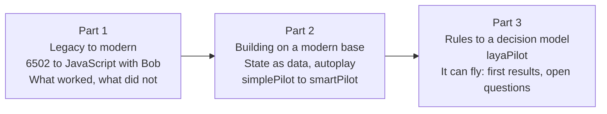

# Outlines: three-part LinkedIn series

Series: **A journey in code modernization with Bob**. The plan, decisions and work breakdown are in [WRITEUP_PLAN.md](WRITEUP_PLAN.md). Diagram, chart, clip and snippet IDs (G, C, V) refer to the tables in section 5 of that plan.

Through-line: in each part "the code" means something different. In Part 1 it is a translation. In Part 2 it is an interface that a program can use. In Part 3 it is the boundary between rules and a model.

Target length: 1,500 to 2,500 words each, plus diagrams, short clips and short code images. Evidence marked **[author]** must come from the author; it is not in the repository (see section 4 of the plan).

---

## Part 1: Porting a 1979 arcade game with an LLM: what worked, what did not

**Working hook:** about 3,650 lines of 6502 assembly became a single JavaScript file that runs in a browser with no build step. The port ran, and it was still wrong in ways that no test noticed until the code was run against the original source.

**Claim:** an LLM translates structure well and fails on conventions that the source never states. Verification by running the code found what reading did not.

| # | Section | Content | Assets |
|---|---------|---------|--------|
| 1 | Why Asteroids | Small, famous, the source is public, the rules are fixed, and correctness can be measured | Screenshot of the original and the port |
| 2 | The task | 16 files, 7,722 lines in total, 3,653 lines of game logic in `A35131.1A` to `A35131.1E`. Goal: a faithful port that runs anywhere | G1 (source set to single file) |
| 3 | How Bob was used | Mode, model, prompts, number of sessions **[author]** | A sample prompt, as text |
| 4 | What worked | Routine-by-routine mapping with opcode comments; vector tables (4 rock shapes, 17 ship frames, saucer, font); bit-exact `RAND`; fixed 60 Hz step; Web Audio replacing the analog sound circuits; the surrounding game flow | G2 (hardware to browser), G5, G6, code: a 6502 routine next to its JavaScript |
| 5 | What did not work | The error catalogue below. For each: the line of source, what was produced, what it did in play | Snippets S1 to S3, table of deviations |
| 6 | Why these errors | They are conventions, not logic: radix, BCD, signed bytes, coordinate direction. A human porter makes the same ones. Do not claim better or worse without a comparison | G3 (where errors came from) |
| 7 | Finding them without an emulator | Headless Node `vm` sandbox, soak tests of 40 games, `compare_versions.js` measuring v1 against v2 on the same seeds; two regressions found only by running the code | G4 (validation harness), V1 |
| 8 | Fidelity is a decision | Particles, ship fade-in and canvas strokes are additions; wave-clear delay 90 against 127. Which differences are bugs and which are choices | Table |
| 9 | What to take away | A checklist for LLM-assisted legacy porting: give the model the assembler directives, test against measured constants, run old against new, keep a frozen baseline | Checklist graphic |

**Error catalogue (all from the repository docs):**

| Error | Source | Effect, measured |
|-------|--------|------------------|
| Saucer firing delay read as 18 instead of decimal 10 (`LDA I,10.` in a `.RADIX 16` file) | `EFIRE` | One shot every 72 frames instead of every 40; about 7 shots per pass instead of 11.5 |
| Saucer vertical speed read as 10 instead of hex 0x10 | `EFIRE` | Saucers drift more slowly than the original |
| Rock-hit timer 50 instead of 0x50 (80) | `SPLIT` | Window for the saucer rock-count check was too short |
| Small saucer threshold 3,000 instead of 30,000 (BCD high byte) | `ENEMY` | At 5,000 points: 420 small saucers and 0 large in a long run, against 442 small and 21 large after the fix |
| Direction change every 256 frames instead of 128 | `EFIRE` | Comment said 128, code did 256 |
| Wave-clear delay 90 instead of 127 | `RDELAY` | Gap between waves 91 ticks instead of 128 |
| Small-saucer aim table switched at 5,300 instead of 35,000 points (found while fixing) | `EFIRE` | Same BCD mistake repeated in the fix |
| Two-player switch left player 2 invisible (found while fixing) | `CHKST1` | Ship never returned; found by a short headless script |

**Snippets:** S1 the radix directive with the wrong and right constant; S2 the BCD threshold; S3 the two-player regression and its one-line fix.

**Clips:** V1 (v1 against v2, same seed, saucer behaviour).

**Open points:** E1 to E6 in the plan. Reword the repo docs that call v1 "manual" (task D1). Do not state how long the port took until the author provides it.

---

## Part 2: Building on a modern code base: making the game playable by a program

**Working hook:** about 170 lines of JavaScript turned the port into an environment a program can play, and a 40 line pilot scored about 600 times the mean of a random player.

**Claim:** once the code is clean and the state is explicit, new capabilities cost lines instead of rewrites. Autoplay needs an observable state, a narrow action interface, and honest measurement.

| # | Section | Content | Assets |
|---|---------|---------|--------|
| 1 | Why a clean base pays off | Port first, features second. What had to be true before autoplay was cheap: one tick function, plain data, a keys table | Layered architecture diagram (new, G7 context) |
| 2 | State as data | `snapshot()` returns a copy; fields; units (0..8191, 0..6143, angle 0..255); the two conventions that bite (`y` grows downward, `ship.vy` is y-up) | Snippet S4, G7 |
| 3 | Decisions as five booleans | `left`, `right`, `thrust`, `fire`, `hyper` written into the same `keys` table the keyboard uses; the game cannot tell a pilot from a person; `fire` and `hyper` are edge triggered, so a pilot must pulse them | Snippet S6, G7 |
| 4 | Making decisions visible | State panel, Decision panel, the `why` string, `LOG_STATE` | Annotated screenshot |
| 5 | `simplePilot`: 40 lines, no memory | Shortest offset across wrapping edges, solve for the torpedo interception time, aim, fire when within 3 units | G8, snippet S5 |
| 6 | Measuring honestly | Seeded runs, bit-exact `RAND`; floors first (idle, random); 3,000,000 ticks (13.9 hours of play) per controller | C1, table |
| 7 | `smartPilot`: look ahead 90 ticks | Replay the ship's own physics; 16 headings x 5 thrust lengths; cheapest safe manoeuvre; hyperspace only as a last resort with a risk estimate | G9, G10 |
| 8 | Proving the pilot does not cheat | `check_thrust_physics.js`: the ship moves only through the keys; 184,025 ticks, 0 mismatches | G11 |
| 9 | Results | Re-measured table (N3): losses per hour, points per minute, thrust share, hyperspace use, causes | C2, C3 |
| 10 | Takeaways | A checklist for making software agent-ready: explicit state, narrow actions, determinism, a proof that the agent follows the rules | Checklist graphic |

**Numbers rule:** use the long run (8 x 1,200,000 ticks): `simplePilot` 69.1 losses per hour and 9,527 points per minute, `smartPilot` 5.7 and 13,992. These differ from the older table in the repo (43.9 and 7.7). See section 3 of the plan and [`data/`](data/README.md).

**Caveats to state:**
- The pilots are strong because torpedoes are about 5 times faster than large rocks (63 against about 13 units per tick). This explanation is consistent with the code but was not tested separately.
- `simplePilot` never dodges and ignores saucer torpedoes; `smartPilot` is the first pilot to use thrust and hyperspace.
- Thrust in short taps makes the ship look as if it moves on its own (hence the 0.4 s dim key display).

**Clips:** V2 (idle, random, `simplePilot`), V3 (`simplePilot` cannot dodge), V4 (`smartPilot` brakes), V4b (hyperspace as a last resort).

---

## Part 3: From rules to a decision model: a model can fly the ship

**Decision (2026-11-10):** Part 3 is limited to a feasibility claim plus honest observations. The measurements are not enough for a verdict on rules against models, and the Laya pilot has not been optimized (latency, prompts and questions are untouched). The rule-based pilots were tuned; Laya was not.

**Working hook:** a 421M parameter decision model, running locally and answering a typed question about the ship's situation, can fly an arcade game. It scores close to the rule-based pilot and survives play for minutes at a time. It also reacts about 100 ms late and loses ships to rocks. This article shows how it is wired, what it does on screen, and what is still to be tested.

**Claim (only this):** a pilot built on a decision model is possible and is capable of playing the game. No claim is made that it is better or worse than rules, beyond reporting the first numbers with their limits.

| # | Section | Content | Assets |
|---|---------|---------|--------|
| 1 | Two kinds of model | Generative (System Two): slow, free text. Decision (System One): one forward pass, a typed choice, calibrated probabilities | G12 |
| 2 | Choosing a model for a laptop | Laya, Kev, d1, Jev, CLM, Clef on an M1 with 16 GB and about 16 GB of disk; why CLM-8B is out; why Laya runs first. Latency figures for the other models are from their documentation and were not measured here | Table from `DECISION_MODELS.md` |
| 3 | The `/v1/systemone` contract | A request with a state sentence and a question with options; a response with a choice and probabilities | Snippet S7 |
| 4 | Architecture | Browser at 60 Hz, a non-blocking `fetch`, and a Python MLX server on `127.0.0.1:8700`; the ship follows the latest answer | G13 |
| 5 | Turning geometry into a sentence | Toroidal shortest path, bearing, closing speed, time to collision; Safe, Danger, Fatal emergency | Snippet S8 |
| 6 | Who does what | The model picks a tactic among four (`stay_and_fire`, `turn_left_and_thrust`, `turn_right_and_thrust`, `hyperspace`); the code does the lead aiming and the key timing. Say plainly that Laya shares the target picker with `smartPilot` (`simplePilot` has its own), which is a likely reason the score is close to `smartPilot` | G14, snippet S9 |
| 7 | When the server is down | Fallback to `smartPilot`, retry every 3 s, resume without a reload | G15, V9 |
| 8 | What we observed | (a) It plays: 12 starting points of 8,000 ticks ran with no fallback and no server error, 10,096 points per minute. (b) What it looks like: bursts of turn and thrust (3.8% of flying ticks) against short taps for `smartPilot` (1.4%). (c) How it dies: all 22 losses in the short run were rocks. (d) It uses hyperspace (19.4 per hour). (e) The decision arrives 90 to 140 ms (5 to 8 ticks) after the request. Each point is reported with its run and its limits. Gameplay observations beyond the measured ones must come from watching the clips, written by the author | C2 to C5 as needed, V5 to V8 |
| 9 | What we have not tried yet | Latency breakdown and ways to cut it; other prompts and state sentences; other questions and action sets; a safety veto; other models; longer runs. Each is a hypothesis, not a result (see backlog in the plan, section 6b) | Roadmap diagram |
| 10 | Rules, models, or both | Where each looks promising, stated as open: rules for geometry and aiming, a model for choosing a tactic. Closing: the next article would test the optimizations | G16 |

**Caveats to state upfront:**
- Only one model (`laya-mlx`) with one prompt design is tested. This is a first result, not a model comparison and not an optimized pilot.
- There is no safety check between the model and the keys, so the numbers show the model's own behaviour.
- The headless Laya run is a simulation: the game waits for the real HTTP answer, then applies it 6 ticks after the request (`--lag=6`), which matches the measured latency. The browser applies answers when they arrive in real time. The article must describe this.
- The Laya row comes from a short run (12 x 8,000 ticks, 22 losses). The rates are imprecise. Do not use the numbers to rank Laya against `simplePilot` (not statistically distinguishable); the ordering against `smartPilot` is clear but is the ordering of an untuned model against a tuned rule set.
- The measured latency (90 to 140 ms) differs from the figure in the model's documentation (7.4 to 13.9 ms). The cause is unknown (the documented figure belongs to the 322M multilingual checkpoint; this run used the 421M `laya-mlx`, which is one untested explanation). Say so.
- Retracted older claims ("about 11 ms", "dodges torpedoes", "never presses hyperspace") are not repeated.

**Clips:** V5 (side by side with a trail), V6 (a good dodge), V7 (a dodge into another rock), V8 (decision panel), V9 (fallback when the server stops).

**Not in scope:** optimization results, a shielded Laya pilot, Kev, Jev, CLM, d1. If the investigation in section 6b of the plan produces results, they become a Part 4.

---

## Snippet list

| ID | Part | Content | Source |
|----|------|---------|--------|
| S1 | 1 | `.RADIX 16`, `LDA I,10.` and the JavaScript constant, wrong and right | `A35131.1A` (link only), `updateSaucer` |
| S2 | 1 | BCD threshold, `CMP I,30` on `SCORE+1` | `ENEMY`, `asteroids.html` |
| S3 | 1 | Two-player switch regression and fix (`ship.sdelay = 0x10`) | `asteroids.html` |
| S4 | 2 | `snapshot()` shape | `asteroids.html` |
| S5 | 2 | Interception equation `abs(offset + v*t) = 63*t` and its solver | `simplePilot` |
| S6 | 2 | The controller contract (five booleans and `why`) | `applyAutopilot` |
| S7 | 3 | `/v1/systemone` request and response | `DECISION_MODELS.md`, `laya_server.py` |
| S8 | 3 | Wrap offset and time to collision | `layaFormatState` |
| S9 | 3 | Choice to keys mapping | `layaPilot` |

## Clip list

| ID | Part | Content | Length | Priority |
|----|------|---------|--------|----------|
| V1 | 1 | v1 against v2, same seed | 8 s | Must |
| V2 | 2 | Idle, random keys, `simplePilot` | 10 s | Should |
| V3 | 2 | `simplePilot` aims precisely, then is hit by something it cannot dodge | 8 s | Must |
| V4 | 2 | `smartPilot` brakes: turns against its velocity, thrusts, stops | 6 s | Must |
| V4b | 2 | `smartPilot` hyperspace as the last resort | 6 s | Could |
| V5 | 3 | `smartPilot` and `layaPilot` side by side, with a ship trail | 10 s | Must |
| V6 | 3 | Laya dodges out of the way of a rock it cannot shoot | 6 s | Must |
| V7 | 3 | Laya dodges one rock into the path of another | 8 s | Must |
| V8 | 3 | Laya with the State and Decision panels visible | 8 s | Should |
| V9 | 3 | Server stops, fallback to `smartPilot`, recovery | 8 s | Could |

Details, sources and constraints for each clip: [WRITEUP_PLAN.md](WRITEUP_PLAN.md) section 5.4.
