# Porting a 1979 Arcade Game with an LLM: What Worked, What Did Not

*Part 1 of the series "A journey in code modernization with Bob: from 6502 assembly to an AI autopilot"*

About 3,650 lines of 1979 MOS 6502 assembly language became a single JavaScript file running in a modern web browser with zero dependencies and no build step. The resulting game ran immediately, rendered vector ships and rocks on an HTML5 canvas, synthesized analog cabinet sounds with the Web Audio API, and looked finished.

It also played like Asteroids, and it was wrong in several places. No syntax error, type check or smoke test caught them. They showed up only when I measured the game and compared it with the original 1979 assembly.

This article examines what happens when an AI assistant (IBM Bob) is tasked with porting legacy assembly code to modern JavaScript: what an LLM handles with ease, where it reliably fails, why unstated legacy conventions trip up machines and humans alike, and how automated headless verification caught what code reading missed.

**Clip 1 (about 20 s):** manual play of the first port (version 1) in a browser. It looks right and plays right, which is exactly why the errors went unnoticed.

*Video file: `docs/articles/linkedin/clip-part1-gameplay.mp4`. Upload it in the LinkedIn editor here.*

---

## 1. Why Asteroids?

There is also a personal reason for choosing Asteroids. I remember playing this game as a kid on real Atari hardware. The premise looked simple, but I always found it harder than other arcade games. The physics of inertia and momentum were unforgiving: the moment you engaged thrust, the ship drifted across the screen, making aiming difficult and precise ship control exhausting.

The survival strategy I developed as a kid was simple: stay in the middle of the screen, rotate in place, fire continuously, and move as little as humanly possible.

Deciding to tackle Asteroids for this modernization series felt like a second chance at a game that had humbled me decades ago. This time I would modernize its code and eventually build autonomous AI pilots to handle the drifting physics that beat me as a kid.

Beyond nostalgia, Asteroids makes a good engineering benchmark for code modernization:

1. **Fixed, deterministic rules**: Unlike enterprise business applications where requirements shift continuously, arcade game logic is frozen in ROM.
2. **Accessible source code**: The original 1979 source by Ed Logg and Lyle Rains is publicly documented.
3. **Measurable correctness**: Timing intervals, collision boxes, rock drift speeds, and enemy fire cadences can be quantified precisely down to individual clock ticks and frames.
4. **Self-contained scope**: The core game logic fits into a few thousand lines of assembly, so a complete port fits in a short project.

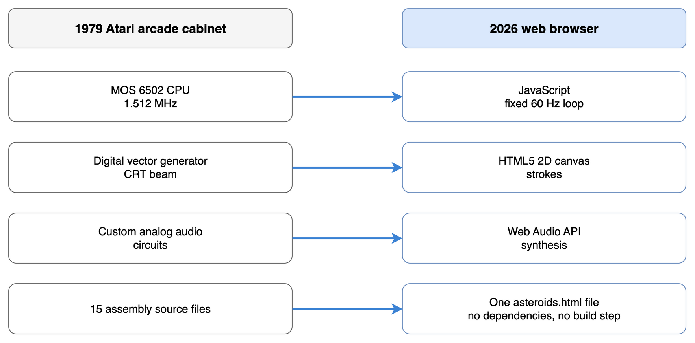

Editable source: [`docs/diagrams/g0-cabinet-to-browser.drawio`](https://github.com/paolob67/Asteroids/blob/main/docs/diagrams/g0-cabinet-to-browser.drawio).

---

## 2. The Task and Source Code Set

The original Atari Asteroids codebase (`asteroids-main/`) comprises 15 assembly, macro and documentation files totaling 5,511 lines. Of those, 3,653 lines across five primary files (`A35131.1A` through `A35131.1E`) contain the active gameplay logic:

- `A35131.1A`: Core game engine (`MOTION`, `MOVE`, `COLIDE`, `NEWAST`, `ENEMY`, `HYPER`, `POINTS`, `GETINT`).
- `A35131.1B` to `A35131.1E`: Game control flow, state machine, and self-test ROM.
- `A35127.XX`: Vector shape definition tables (rock polygons, 17 rotational ship frames, saucer geometry, explosion vector paths).
- `VECAN.XX`: Vector font tables for alphanumeric score and credit displays.
- `RTMUL.XX` and `RTMLCR.XX`: Math utility macros and hardware register definitions.

The modernization goal was clear: produce a single, self-contained [`asteroids.html`](https://github.com/paolob67/Asteroids/blob/main/asteroids.html) file that runs in any modern browser without external libraries, bundlers, or transpilations, while faithfully preserving original game physics and mathematical constants.

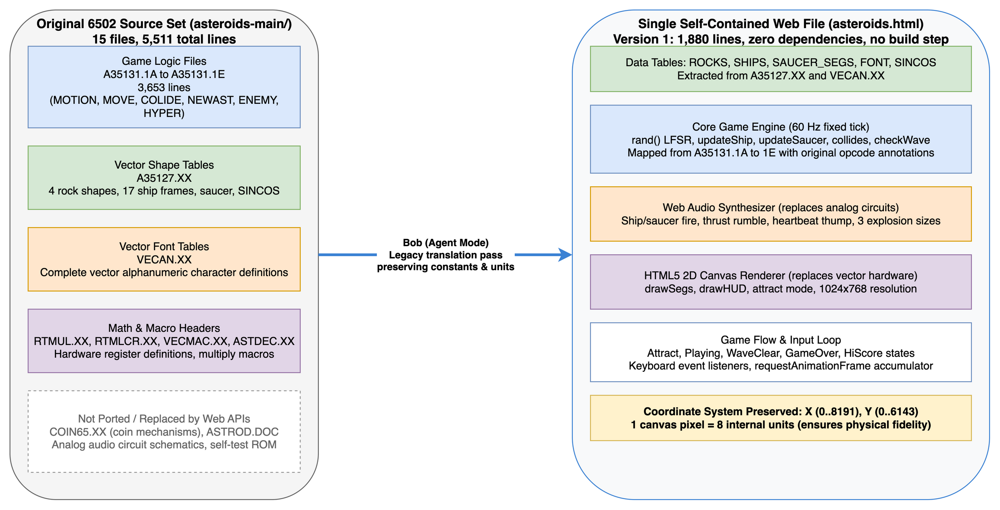

Editable source: [`docs/diagrams/g1-source-mapping.drawio`](https://github.com/paolob67/Asteroids/blob/main/docs/diagrams/g1-source-mapping.drawio).

---

## 3. How Bob Was Used

The port was conducted using IBM Bob in its built-in Agent mode.

### The Workflow
1. **Source ingestion**: The complete 6502 assembly files were downloaded into the local workspace folder (`asteroids-main/`) for Bob to index and review.
2. **Initial prompt**: The opening prompt directed Bob to analyze the assembly files, extract the coordinate system, and translate the routines into a single JavaScript file rendering to an HTML5 canvas.
3. **The first-pass prototype**: The very first generation produced a running canvas with ship movement and rock shooting, but lacked the game's full lifecycle: wave progression was missing (clearing rocks left an empty void), 1-player and 2-player turn switching was absent, audio was not yet synthesized, and the high-score initials table was omitted.
4. **Iterative orchestration**: Over a two-hour session, follow-up prompts directed Bob to connect the fragmented legacy routines into a complete state machine: hooking up wave transitions, synthesizing Web Audio circuits, adding turn switching, and implementing vector font initials entry.
5. **Time investment**:
   - Approximately **2 hours of wall-clock time** produced Version 1 (`versions/v1/asteroids.html`), a 1,880-line fully playable baseline with all screens and sound.
   - Another **2 hours of wall-clock time** was spent finding mathematical discrepancies, fixing unstated convention bugs and restoring behavioral fidelity for Version 2 (`versions/v2/asteroids.html`).

---

## 4. What Worked on the Initial Pass

Large language models excel at local structural decomposition and direct algorithmic mapping. In the initial translation pass, Bob succeeded across several challenging algorithmic areas:

### 1. Routine-by-Routine Structural Mapping
Bob mapped individual 6502 routines directly into corresponding JavaScript functions, documenting the original assembly labels and opcodes in inline comments:
- `MOTION` (line 1172) became position integration in `updateShip()`, `updateAsteroids()`, and `updateSaucer()`.
- `COLIDE` (line 396) became `collides()`, preserving the half-distance bounding box logic and corner-clipping tests.
- `NEWVEL` (line 1538) became `newVelComp()`, preserving velocity calculation and split momentum.

### 2. Coordinate System Preservation
Instead of remapping coordinates to standard pixel screen dimensions (e.g., 800x600), Bob retained Atari's internal 13-bit coordinate system:
- Internal game world: `X` spanning `0..8191` and `Y` spanning `0..6143`.
- Screen display: Rendered onto a 1024x768 canvas by dividing internal positions by 8 (`canvas_x = x / 8`).
Keeping the native coordinate space meant that rock velocities, friction decay rates, and collision radiuses did not require recalibration.

### 3. Bit-Exact Random Number Generator
Atari Asteroids relies on a 2-byte Linear Feedback Shift Register (`RAND`, line 2393) to control rock splits, saucer appearances, and shot errors. Bob translated this 16-bit shift logic bit-for-bit into JavaScript:

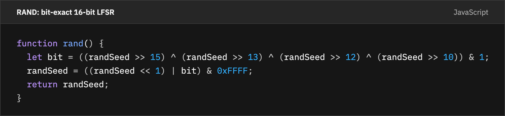

Code source: [`snippets.json`](https://github.com/paolob67/Asteroids/blob/main/docs/articles/linkedin/snippets.json) (`rand-lfsr`).

Because `rand()` is bit-exact, entire 20,000-frame gameplay runs are 100% deterministic when initialized with the same random seed.

### 4. Hardware to Browser API Synthesis
Rather than loading recorded WAV samples, Bob implemented sound effects entirely via the Web Audio API to mirror the original discrete analog circuits:
- **Ship Fire**: Exponential frequency drop from 1,000 Hz to 220 Hz.
- **Heartbeat Thump**: Alternating 115 Hz and 98 Hz tones accelerating as the rock count decreases.
- **Explosions**: Three distinct band-pass and low-pass noise envelopes tailored to large, medium, and small targets.

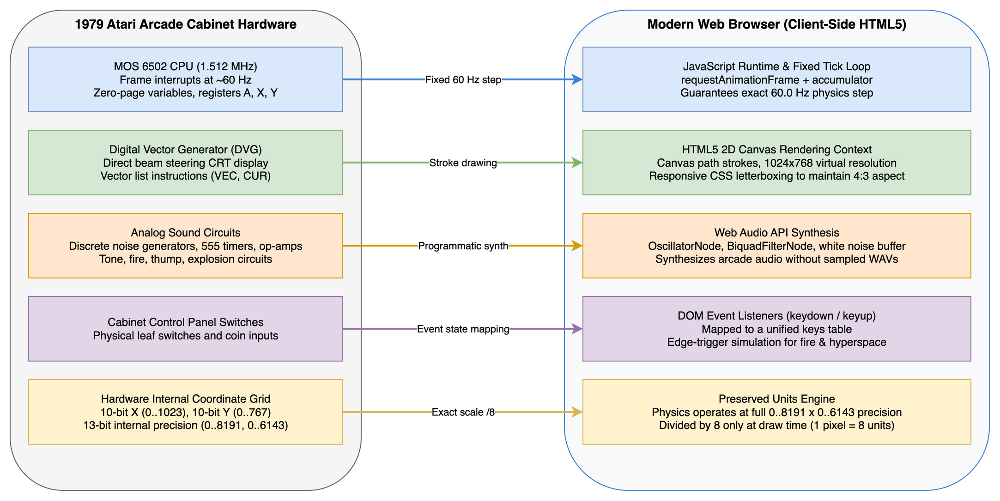

Editable source: [`docs/diagrams/g2-hardware-to-browser.drawio`](https://github.com/paolob67/Asteroids/blob/main/docs/diagrams/g2-hardware-to-browser.drawio).

---

## 5. What Did Not Work: The Error Catalogue

The challenges encountered fell into two distinct phases: **lifecycle gaps in the initial translation pass**, and **deep mathematical convention bugs in the Version 1 baseline**.

### Initial Pass Shortcomings
In the very first output generated by Bob, several entire subsystems were omitted or disconnected:
- **Wave progression missing**: When all rocks were destroyed, the game simply sat in an empty screen. The `NEWAST` wave-spawning logic existed in isolation but was not hooked into the main game loop.
- **One and two player modes missing**: Turn-switching logic (`CHKST1`, `NPLAYR`) and player score preservation were omitted, limiting the game to a single endless credit.
- **High score table omitted**: Top-10 ranking and 3-letter vector initials entry (`SCORES`, `GETINT`, `UPDATE`) were absent.
- **Audio missing**: Analog sound circuits were not synthesized on the initial prompt.
- **Geometry and visual artifacts**: Ship weapon firing angles were miscalculated, canvas scaling required recalibration, and a persistent visual glitch offset the thrust flame behind the ship.

### Version 1 Behavioral & Mathematical Bugs
Once the missing systems were integrated to create Version 1, the game looked complete. Running it and comparing it line by line with the assembly then turned up these fidelity bugs:

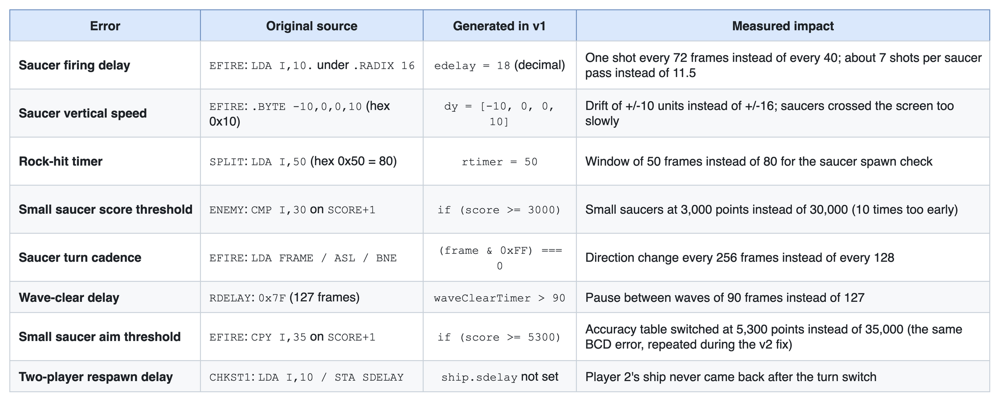

Editable source: [`docs/diagrams/p1-error-catalogue.drawio`](https://github.com/paolob67/Asteroids/blob/main/docs/diagrams/p1-error-catalogue.drawio).

---

## 6. Why These Errors Occurred

None of these mistakes were caused by a failure of JavaScript logic. Every line of code generated by Bob was syntactically valid and followed sensible programming practices.

The failures came from two causes: **the lifecycle gap** and **implicit assembler conventions**.

### 1. The Lifecycle Gap (Local Logic vs System Flow)
Legacy systems are fragmented. The Asteroids source spans 15 separate files, with state transitions triggered by hardware interrupt flags, jump tables, and memory-mapped I/O registers.

An LLM excels at local comprehension: translating a 40-line assembly subroutine into a clean JavaScript math function is straightforward. An LLM initially struggles to see the **whole application lifecycle**. It translates the parts without automatically orchestrating the global state machine:

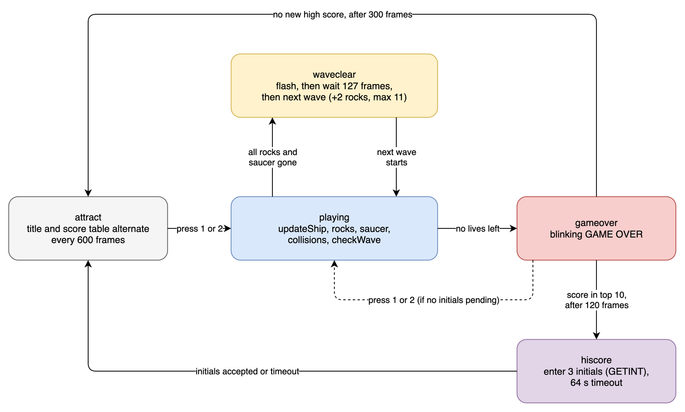

Editable source: [`docs/diagrams/v1-game-states.drawio`](https://github.com/paolob67/Asteroids/blob/main/docs/diagrams/v1-game-states.drawio).

Because the lifecycle was not unified in a single top-level assembly routine, Bob translated the rock-splitting and saucer logic, but initially overlooked connecting the wave completion trigger (`checkWave()`) back to the wave initialization routine (`startWave()`). Human direction was required to prompt Bob on the full macro-architecture: Attract mode, 1-vs-2 player turn alternation, wave clearing delays, and the high score initials screen.

### 2. Assembler Directives: The `.RADIX 16` Trap
In Atari's MACRO-11 style assembler, file `A35131.1A` opens with the directive `.RADIX 16`. This directive changes the default number base:
- A bare number like `50` or `10` is **hexadecimal** (`0x50 = 80`, `0x10 = 16`).
- A number with a trailing dot like `10.` is **decimal** (`10`).

When Bob translated `LDA I,10.` in routine `EFIRE`, it read `10` without noticing the trailing decimal dot under hexadecimal radix, copying an earlier variable initialized to 18. When translating `.BYTE -10,0,0,10`, it read the numbers as decimal 10 rather than hexadecimal `0x10` (16).

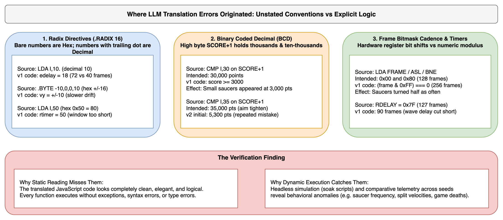

Editable source: [`docs/diagrams/g3-error-sources.drawio`](https://github.com/paolob67/Asteroids/blob/main/docs/diagrams/g3-error-sources.drawio).

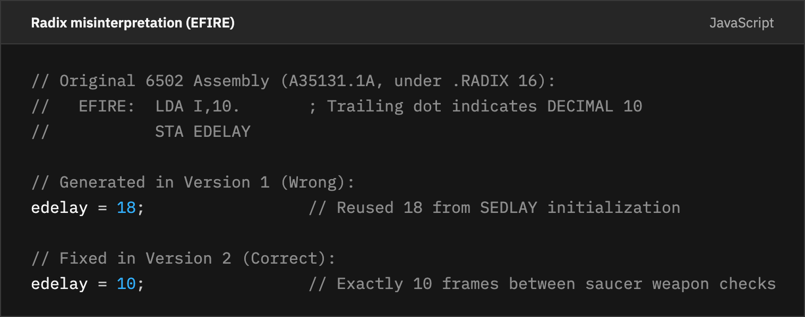

Code source: [`snippets.json`](https://github.com/paolob67/Asteroids/blob/main/docs/articles/linkedin/snippets.json) (`radix`).

### 2. Binary Coded Decimal (BCD) Packing
Arcade hardware stores player scores in Binary Coded Decimal (BCD) to simplify driving seven-segment LED displays and vector character drawing. In Asteroids, `SCORE` is a 2-byte array:
- `SCORE+0`: Low byte containing the tens and hundreds digits (the display code appends a fixed zero, so the ones digit is never stored).
- `SCORE+1`: High byte containing the thousands and ten-thousands digits.

When `ENEMY` executes `CMP I,30` against `SCORE+1`, it compares the byte containing the thousands digits against hex `0x30`, representing **30,000 points**. 

Bob interpreted `30` as standard decimal, converting it to `3,000` points:

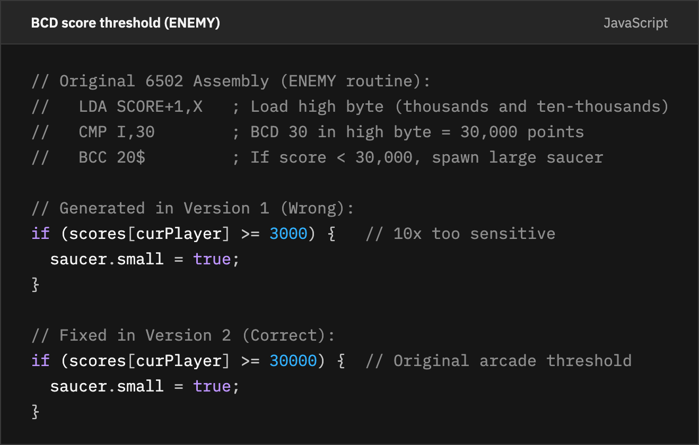

Code source: [`snippets.json`](https://github.com/paolob67/Asteroids/blob/main/docs/articles/linkedin/snippets.json) (`bcd-threshold`).

Because of this single misunderstanding, small saucers (which shoot with lethal accuracy) spawned after clearing only two waves of asteroids, drastically warping the difficulty curve.

### 3. Bitmask Cadence vs Modulo Arithmetic
In 6502 assembly, checking periodic intervals is frequently done with shift instructions:

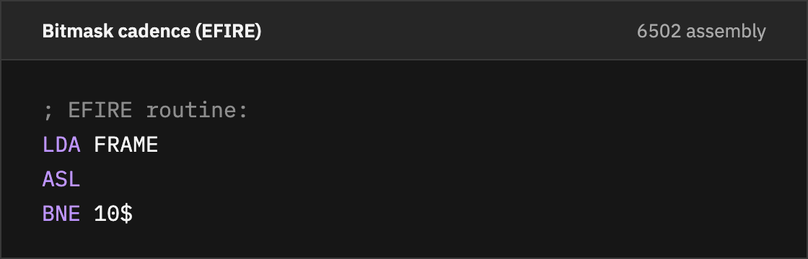

Code source: [`snippets.json`](https://github.com/paolob67/Asteroids/blob/main/docs/articles/linkedin/snippets.json) (`asl-cadence`).

`ASL` (Arithmetic Shift Left) shifts the highest bit of `FRAME` into the Carry flag. If the lower 7 bits are zero, the accumulator is zero, branching when `FRAME` is `0x00` or `0x80`. This triggers an event **every 128 frames**.

Bob translated this check as `(frame & 0xFF) === 0`, testing only when all 8 bits were zero, firing the event **every 256 frames** (half as often as intended), despite writing "every 128 frames" in the comment!

---

## 7. Finding Errors Without an Emulator

Because this project did not involve running a cycle-accurate 6502 emulator side-by-side, how were these behavioral discrepancies discovered and verified?

The solution was a **headless Node.js validation harness** using the built-in `vm` module:

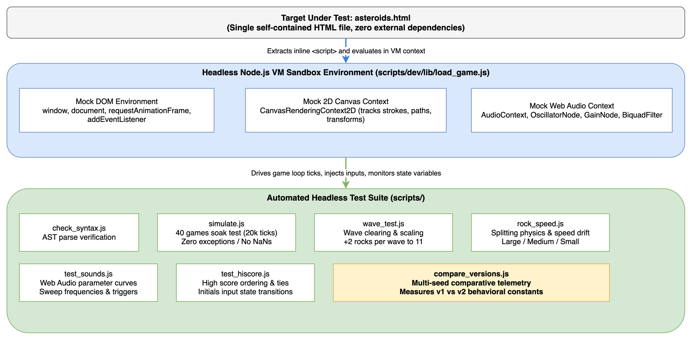

Editable source: [`docs/diagrams/g4-validation-harness.drawio`](https://github.com/paolob67/Asteroids/blob/main/docs/diagrams/g4-validation-harness.drawio).

### The Headless Sandbox (`scripts/dev/lib/load_game.js`)
The test runner extracts the inline `<script>` block directly from [`asteroids.html`](https://github.com/paolob67/Asteroids/blob/main/asteroids.html) and executes it inside an isolated Node.js context with stubbed browser objects (`window`, `document`, mock 2D canvas context, and mock Web Audio context).

```bash
# Run the complete headless test suite
scripts/run_all.sh asteroids.html
```

### The Test Suite
1. [`simulate.js`](https://github.com/paolob67/Asteroids/blob/main/scripts/dev/simulate.js): Executes a soak test of 40 consecutive games with pseudo-random keyboard input across 20,000 frames each (800,000 total ticks), verifying that no state values produce `NaN`, out-of-bounds positions, or unhandled exceptions.
2. [`rock_speed.js`](https://github.com/paolob67/Asteroids/blob/main/scripts/dev/rock_speed.js): Measures the exact pixel-per-frame velocity distribution across rock generations (Large: 1.66 px/frame, Medium: 2.29 px/frame, Small: 2.57 px/frame), confirming that velocity drift matches `NEWVEL`.
3. [`wave_test.js`](https://github.com/paolob67/Asteroids/blob/main/scripts/dev/wave_test.js): Clears all rocks artificially to verify that wave progression scales up to 11 rocks as defined in `NEWAST`.
4. [`test_sounds.js`](https://github.com/paolob67/Asteroids/blob/main/scripts/dev/test_sounds.js): Validates Web Audio parameter ramps and oscillator frequencies against a mock audio graph.
5. [`compare_versions.js`](https://github.com/paolob67/Asteroids/blob/main/scripts/dev/compare_versions.js): Runs Version 1 and Version 2 headlessly with identical random seeds to measure discrepancies in saucer spawn rates, shot counts, and death rates.

### Regression Caught by Automated Validation
During the Version 2 fixes, updating the two-player switch routine inadvertently omitted setting `ship.sdelay = 0x10`. In a two-player game, when Player 1 died, Player 2's turn started, but the ship remained invisible and unresponsive forever. 

Human testing on single-player games missed this completely; the headless multi-player test suite caught it immediately.

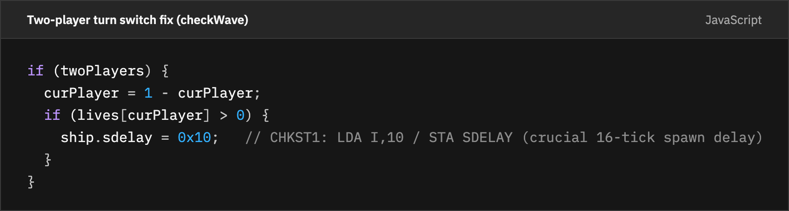

Code source: [`snippets.json`](https://github.com/paolob67/Asteroids/blob/main/docs/articles/linkedin/snippets.json) (`two-player-switch`).

---

## 8. Fidelity is a Decision: Additions vs Bugs

When modernizing a classic codebase, one must distinguish between unintended bugs and intentional design enhancements:

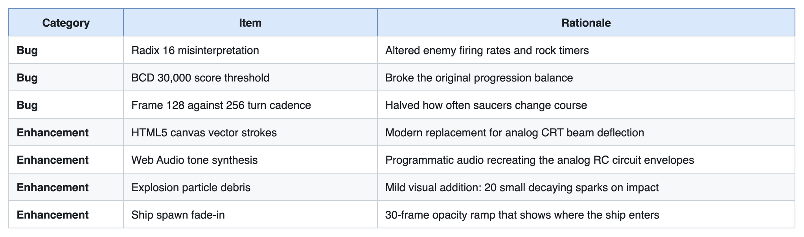

Editable source: [`docs/diagrams/p1-bug-vs-enhancement.drawio`](https://github.com/paolob67/Asteroids/blob/main/docs/diagrams/p1-bug-vs-enhancement.drawio).

Fidelity is about behavior: game mechanics, physics and mathematical constraints must match the original specification, while hardware limitations can be replaced.

---

## 9. Key Takeaways for LLM Legacy Modernization

Porting legacy code with an AI assistant cut days of boilerplate transcription to hours, but treating the first output as finished code is dangerous.

### The Modernization Checklist

1. **Map the global lifecycle before translating subroutines**: Legacy systems scatter state transitions across disjoint files. Provide the LLM with an explicit state transition diagram (Attract -> Playing -> Round Clear -> GameOver -> HiScore) so it connects local routines into the full lifecycle from the start.
2. **Explicitly extract assembler directives first**: Always inspect files for `.RADIX`, `.BYTE`, `.WORD`, and endianness directives before feeding code to an LLM. Instruct the model specifically on numeric base conventions.
3. **Beware of packed binary representations**: Legacy architectures frequently pack numbers into BCD, bitfields, or high/low byte registers. Ensure the prompt explicitly explains score and math representations.
4. **Preserve internal units**: Do not convert legacy unit scales to modern conventions mid-translation. Keep the original integer coordinate grids and scale only at rendering boundaries.
5. **Build a headless harness immediately**: Create an isolated test harness (such as Node.js `vm`) on day one. Long before writing UI features, run 100,000-tick automated soak tests.
6. **Freeze verifiable baselines**: Tag and freeze intermediate versions (with SHA-256 checksums) so you can run comparative multi-seed telemetry between versions.

---

## Summary and What Comes Next

In roughly two hours, Bob translated 3,653 lines of 6502 assembly into a functional, self-contained JavaScript game. In another two hours of telemetry and headless testing, the convention-related discrepancies I found were isolated and resolved, yielding the frozen, verified **Version 2** baseline.

With the physics, state loop and math modernized, the code was an open, inspectable environment ready for automated control.

In **Part 2**, I show what happens when the game state is exposed as plain data: building an autonomous rule-based pilot in 40 lines of code, looking ahead 90 ticks with physics simulation, and proving the pilot never cheats.

---

### Commands to Reproduce

All code, data, diagrams, and validation scripts are available in the repository:

```bash
# Verify the frozen Version 1 baseline
cd versions/v1 && shasum -a 256 -c SHA256SUMS
scripts/run_all.sh versions/v1/asteroids.html

# Run the comparison between Version 1 and Version 2
node scripts/dev/compare_versions.js versions/v1/asteroids.html versions/v2/asteroids.html

# Execute the 800,000-frame soak simulation
node scripts/dev/simulate.js asteroids.html
```

The game, the frozen versions 1 to 3, the measurement scripts and the raw data are all in the repository: [github.com/paolob67/Asteroids](https://github.com/paolob67/Asteroids).

*Next: [Part 2: Once the code is modern, a game becomes something a program can play](https://github.com/paolob67/Asteroids/blob/main/docs/articles/linkedin/part-2-building-on-a-modern-base.md)*
