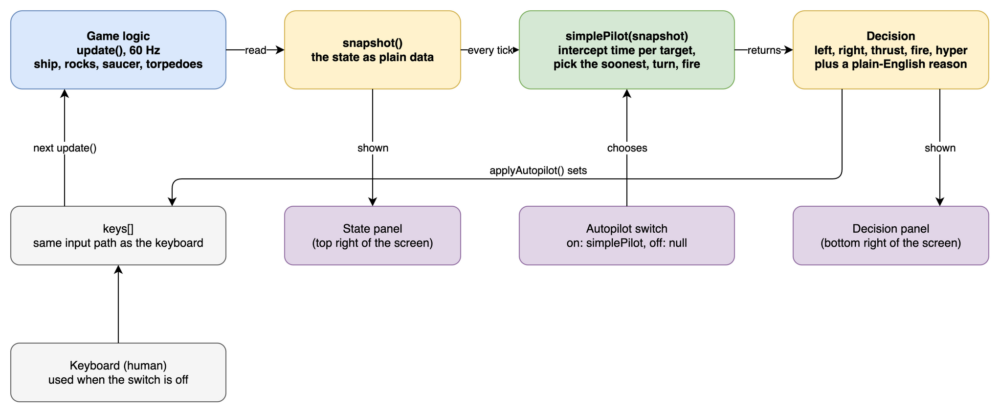
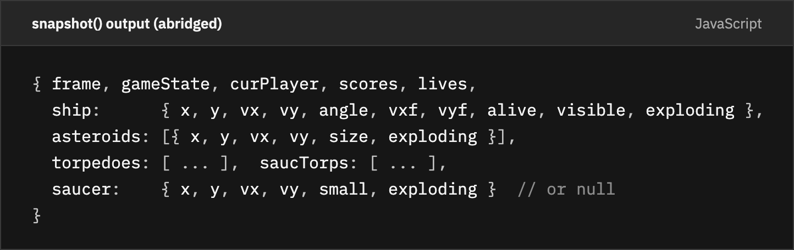
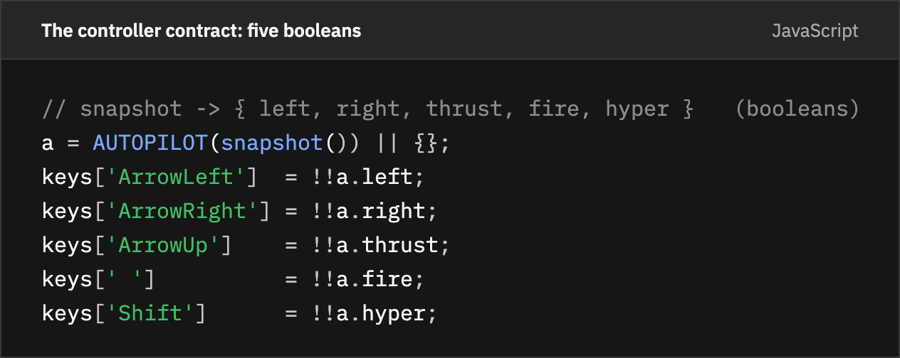
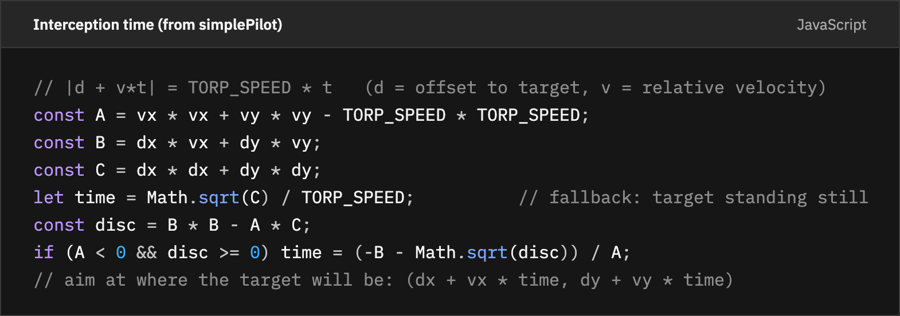
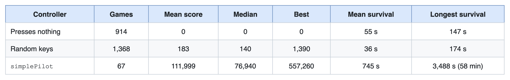
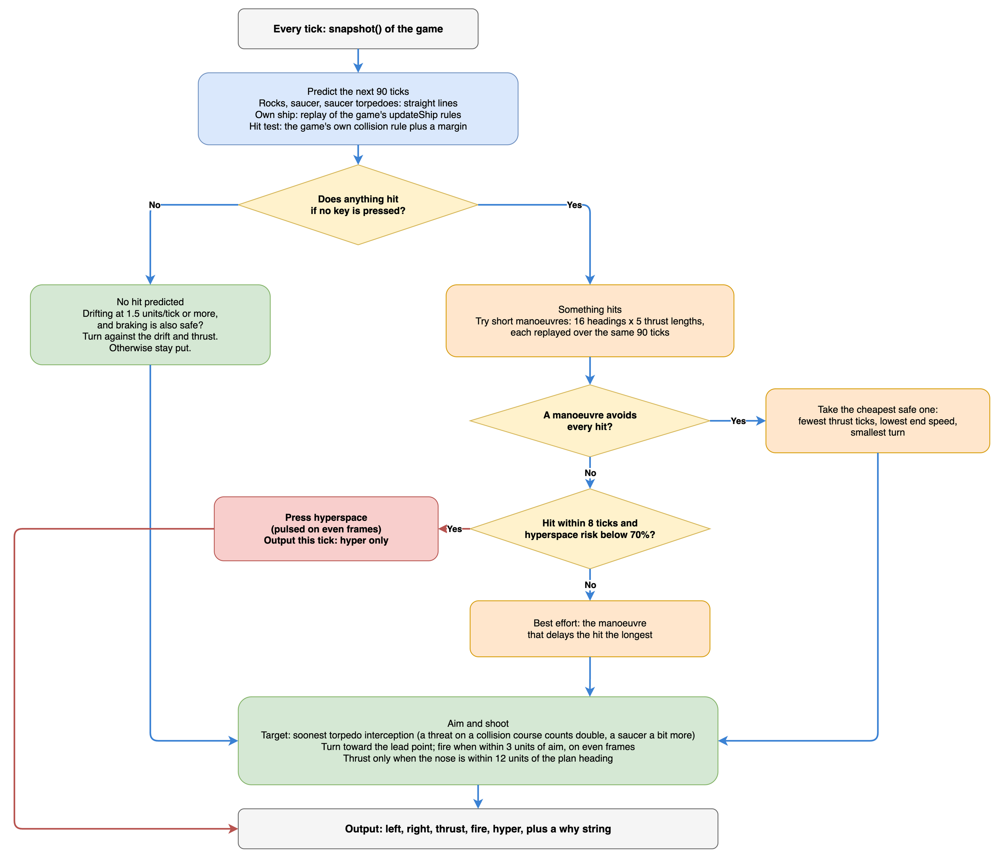
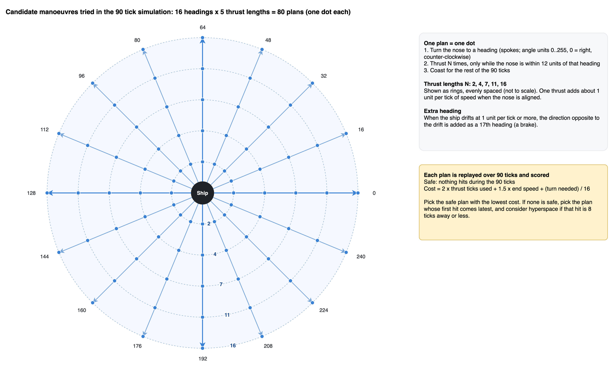
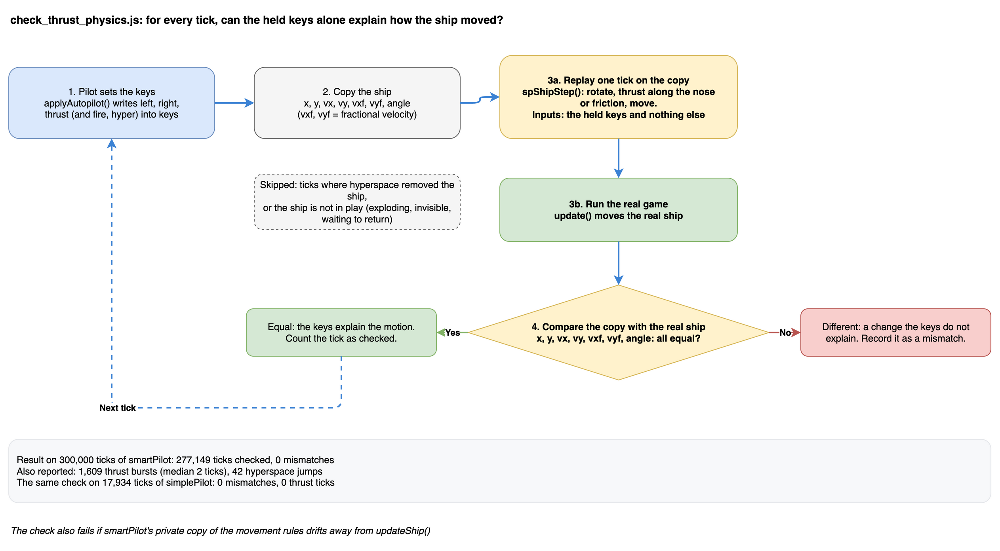
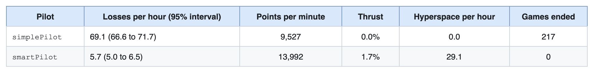
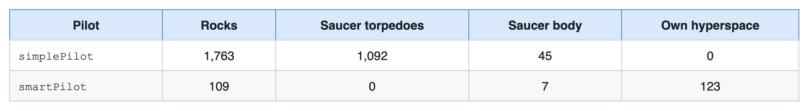

# Once the Code Is Modern, a Game Becomes Something a Program Can Play

*Part 2 of the series "A journey in code modernization with Bob: from 6502 assembly to an AI autopilot"*

In [Part 1](https://github.com/paolob67/Asteroids/blob/main/docs/articles/linkedin/part-1-legacy-to-modern.md), a 1979 arcade game written in 6502 assembly became one JavaScript file that runs in a browser. The interesting part came afterwards. About 170 lines of JavaScript (plus about 90 lines of HTML and CSS for two panels) turned that port into an environment a program can play. A pilot of about 40 lines, with no memory between frames, scored roughly 600 times the mean of a player pressing random keys.

This article is about why that was cheap, what the two pilots I built on top of it do, and how I checked that they play by the rules of the game and not by cheating. The claim is small and specific: once the code is clean and the state is explicit, new capabilities cost lines instead of rewrites.

---

## 1. Why a Clean Base Pays Off

The order mattered. I did the port first and the features second. By the end of Part 1 the game had three properties that autoplay needs, all of them a direct result of the port:

1. **One tick function.** The whole game advances in a single fixed 60 Hz step. A program can call it as often as it likes, in a browser or in Node.
2. **Plain data.** Rocks, torpedoes, the saucer and the ship are small objects with `x`, `y`, `vx`, `vy`. There is no hidden state behind a hardware register.
3. **A keys table.** The game reads the player's input from one object, `keys`. The keyboard handler writes to it.

A fourth property came from the bit-exact `RAND` routine: the game is deterministic. The same seed and the same keys always give the same game. That is what makes every number in this article repeatable.



Editable source: [`docs/diagrams/v2-state-decision-loop.drawio`](https://github.com/paolob67/Asteroids/blob/main/docs/diagrams/v2-state-decision-loop.drawio).

---

## 2. State as Data

The first step was a function that returns the whole game as one plain object. `snapshot()` returns a copy, so a controller cannot change the game through it. This is the shape, abridged:



Code source: [`snippets.json`](https://github.com/paolob67/Asteroids/blob/main/docs/articles/linkedin/snippets.json) (`snapshot`).

Units are the original ones: `x` is 0..8191, `y` is 0..6143, `angle` is 0..255 for a full turn. Two conventions bite, and they are documented in the code: `y` grows downward and wraps at the edges, and `ship.vy` is y-up while every other `vy` is already in screen space.

The same function feeds a State panel on the page and a debug switch (`LOG_STATE`) that prints one JSON line per tick. One representation serves the human, the logger and the pilot.

---

## 3. Decisions as Five Booleans

The second step was a narrow action interface. A pilot is a function from a snapshot to five booleans: `left`, `right`, `thrust`, `fire`, `hyper`. `applyAutopilot()` writes them into the same `keys` table the keyboard uses:



Code source: [`snippets.json`](https://github.com/paolob67/Asteroids/blob/main/docs/articles/linkedin/snippets.json) (`controller-contract`).

The game cannot tell a pilot from a person. That is the point, and it is also the basis of the "no cheating" check in section 8. One detail a pilot must respect: `fire` and `hyper` are edge triggered, as on the cabinet, so holding the key fires once. A pilot has to pulse them, for example on even frames.

---

## 4. Making Decisions Visible

A decision you cannot see is hard to debug. The page has two panels next to the game:

- **State**: the snapshot as text, refreshed every frame.
- **Decision**: who is in control, the five keys as lit buttons, the reason for the current choice (a `why` string every pilot returns), and the decision as JSON.

A line from the Decision panel reads, for example: *"Nearest interception: 25 ticks away. Aim is off by -123 units (-173 deg), so rotate right."* When a pilot does something odd, the reason is on screen.

---

## 5. `simplePilot`: 40 Lines, No Memory

The first pilot does one thing: aim well.

1. For each rock and the saucer, take the shortest offset to the ship across the wrapping edges.
2. Take the target's velocity relative to the ship.
3. Solve for the time `t` at which a torpedo (63 units per tick) meets the target: `|offset + relative_velocity * t| = 63 * t`.
4. Choose the target with the smallest `t`, turn toward where it will be, and fire when the aim error is 3 units or less.



Code source: [`snippets.json`](https://github.com/paolob67/Asteroids/blob/main/docs/articles/linkedin/snippets.json) (`interception`).

What it does not do matters as much. Its output has only `left`, `right` and `fire`. It never returns `thrust` or `hyper`, so it cannot move and cannot jump. It sits in the centre and shoots. It also ignores saucer torpedoes.

**Clip 2 (about 11 s):** `simplePilot` playing the game on its own, with no keyboard input from me.

*Video file: `docs/articles/linkedin/clip-part2-gameplay.mp4`. Upload it in the LinkedIn editor here.*


---

## 6. Measuring Honestly

A claim like "scored 600 times a random player" needs a floor. [`measure_autopilot.js`](https://github.com/paolob67/Asteroids/blob/main/scripts/dev/measure_autopilot.js) gives three controllers the same budget on the frozen Version 2: 3,000,000 ticks (about 13.9 hours of play at 60 Hz), restarting a one-player game each time one ends.



Editable source: [`docs/diagrams/p2-baselines.drawio`](https://github.com/paolob67/Asteroids/blob/main/docs/diagrams/p2-baselines.drawio).

Two floors, because they answer different questions. The idle row shows how long the game takes to kill a player who does nothing. The random row shows what noise alone achieves.

The runs are repeatable: the same command prints the same numbers. Scores are for player 1 only, and they include the extra life every 10,000 points.

The table shows that the pilot is strong. It does not show why. One explanation consistent with the code is that a torpedo (63 units per tick) is about five times faster than a large rock (about 13), so a straight-line prediction is nearly always right, and choosing the soonest interception also removes the closest threat first. I did not test this separately.

---

## 7. `smartPilot`: Look Ahead 90 Ticks

`simplePilot` is strong because it shoots well, and it dies because it cannot avoid anything. The second pilot keeps the same aiming and adds a model of the rules.

Every tick, `smartPilot` asks one question: *if I press nothing special, does anything hit me in the next 90 ticks?*

1. **Predict.** Rocks, the saucer and saucer torpedoes never change course, so each is moved forward in a straight line. The ship's own motion (rotation, thrust, friction) is replayed tick by tick with a copy of the game's `updateShip` rules. Hits use the game's own `COLIDE` rule plus a small safety margin.
2. **Nothing hits.** Stay, aim and shoot. If the ship is drifting and braking is also safe, turn against the drift and thrust.
3. **Something hits.** Try 16 headings times 5 thrust lengths (plus the direction opposite to the current drift). Each candidate is: turn to the heading, thrust N times, then coast. Take the cheapest one that avoids every hit; the cost prefers fewer thrust ticks, a lower end speed and a smaller turn.
4. **Nothing is safe, and the hit is 8 ticks away or less.** Estimate the risk of hyperspace and press it if the risk is below 70%.

Hyperspace is a gamble in the original game. The arcade code marks the ship for destruction when a random value passes a threshold that depends on the rock count, and the ship re-enters 48 ticks later at a random spot that may be in the path of something. The pilot estimates both parts. The "last resort" window was tuned from 24 ticks down to 8, because 24 caused avoidable self-destructs.



Editable source: [`docs/diagrams/g9-smartpilot-flow.drawio`](https://github.com/paolob67/Asteroids/blob/main/docs/diagrams/g9-smartpilot-flow.drawio).

The search in step 3 is small enough to draw. Each dot below is one plan, a heading (spoke) combined with a thrust length (ring), and each is replayed over the same 90 ticks:



Editable source: [`docs/diagrams/g10-candidate-manoeuvres.drawio`](https://github.com/paolob67/Asteroids/blob/main/docs/diagrams/g10-candidate-manoeuvres.drawio).

Watching it play, it brakes by turning the ship round and thrusting, which keeps movement to a minimum. Measured over 8 x 100,000 ticks: thrust is held for 1.6% of flying ticks, in bursts of about 3 ticks, and the ship drifts (speed of 1.5 units per tick or more) 7% of the time. One gap I saw by eye is confirmed by the code: nothing in its cost refers to the centre of the field, so it does not return to the centre after it has moved away.


---

## 8. Proving the Pilot Does Not Cheat

A pilot that can see every rock and predict the future invites a fair question: does it play by the game's rules, or does it nudge the ship in a way a human could not?

The pilot has no way to set the ship's velocity. It can only hold five keys, and the game's `updateShip()` does the rest. [`check_thrust_physics.js`](https://github.com/paolob67/Asteroids/blob/main/scripts/dev/check_thrust_physics.js) proves this for a run. Each tick it replays the game's movement rules (rotate, thrust along the nose, friction) from the held keys alone and compares the result with the real ship.



Editable source: [`docs/diagrams/g11-physics-proof.drawio`](https://github.com/paolob67/Asteroids/blob/main/docs/diagrams/g11-physics-proof.drawio).

For `smartPilot` over a 300,000 tick run: 277,149 ticks checked, 0 mismatches. (The remaining ticks are skipped: the ship was exploding, waiting to return, or had been taken away by hyperspace, which the replay does not model.) Position, velocity (including the fractional part) and angle matched the replay on every checked tick, so every speed gain happened on a tick where THRUST was held, in the direction the nose pointed. The check also fails if the pilot's private copy of the movement rules drifts from `updateShip()`. The same check passes for `simplePilot` (257,464 ticks, 0 mismatches), which proves less: it never thrusts, so only rotation and friction were exercised.

This also explained a puzzle from Version 2. Because `smartPilot` thrusts in short taps (median burst of 2 ticks), the ship spends most of its time coasting, and it looked as if it moved by itself. The Decision panel now keeps a recently pressed key dimly lit for 0.4 s and says whether the ship is thrusting or coasting.

---

## 9. Results

[`measure_pilots.js`](https://github.com/paolob67/Asteroids/blob/main/scripts/dev/measure_pilots.js) runs each pilot from several starting points with one set of definitions. Flying time is the ticks spent in the `playing` state. A loss is a call that removes a life, counted inside the game code.

Long run, 8 starting points of 1,200,000 ticks each (about 42 flying hours per pilot):



Editable source: [`docs/diagrams/p2-long-run.drawio`](https://github.com/paolob67/Asteroids/blob/main/docs/diagrams/p2-long-run.drawio).

`smartPilot` loses a ship about 12 times less often and scores 47% more points per minute. It also never ended a game, while `simplePilot` ended 217. The two intervals are far apart: 2,900 and 239 losses are enough events to trust this gap.

What kills them, from the same run:



Editable source: [`docs/diagrams/p2-loss-causes.drawio`](https://github.com/paolob67/Asteroids/blob/main/docs/diagrams/p2-loss-causes.drawio).

Two readings, each with its limit.

- **A pilot that cannot move cannot avoid a torpedo.** Saucer torpedoes account for 38% of `simplePilot` losses. I first expected most of its deaths to come from several rocks arriving at once; the counters say otherwise. In a separate 8 x 100,000 tick run, 206 of its 236 losses (87%) came with zero or one threat closing. The counter tracks rocks and saucers closing within 60 ticks and 1,200 units and does not count saucer torpedoes, so this is a rough picture, not a loss-by-loss audit.
- **The best remaining cause for `smartPilot` is itself.** 123 of its 239 losses were hyperspace self-destructs. The last-resort jump is a good trade against a certain hit, and still the largest single cause. This is the headroom for a better pilot.

These are the numbers after a correction. An earlier table in the repo showed 43.9 and 7.7 losses per hour and described them as coming from this long run; they were the figures of a much shorter run. Re-measuring everything with one script and one set of definitions moved the ratio from about 6 times to about 12 times. I now treat a number without its run attached as unfinished.

---

## 10. Takeaways: Making Software Agent-Ready

This was ordinary engineering that happened to be the right shape for agents:

1. **Make the state explicit.** One function that returns the whole world as plain data, as a copy.
2. **Keep the action interface narrow.** Five booleans into the same table a person uses. The less an agent can do, the easier it is to reason about and to check.
3. **Make it deterministic.** Seeded randomness turns every result into a command anyone can re-run.
4. **Make decisions visible.** A reason string and a panel cost almost nothing and save hours of debugging.
5. **Measure with floors and intervals.** Idle and random baselines first; losses per hour with the run attached.
6. **Prove the agent follows the rules.** A replay that explains every change in the ship's state from the keys alone.

With this in place, Part 3 needs no changes to the game. The next pilot uses the same snapshot and the same five booleans, and swaps the rule-based brain for a neural decision model.

---

## Summary and What Comes Next

The explicit state and the five-boolean interface turned a ported game into an environment for about 170 lines. A 40 line aiming rule made a strong player that cannot dodge; a 90 tick lookahead lost a ship about 12 times less often over 42 flying hours, and a replay of the game's own physics showed it never moved the ship by any route but the keys.

In **Part 3**, the rules are replaced by a small decision model that runs locally on a laptop and picks the ship's tactic from a one-sentence description of the situation. The claim there is narrower than here: it is possible, it plays, and here is what it looks like.

---

### Commands to Reproduce

```bash
# Version 2: idle, random and simplePilot (under 10 seconds)
node scripts/dev/measure_autopilot.js versions/v2/asteroids.html 3000000

# Version 3: long run for the two rule-based pilots (about 3 minutes)
node scripts/dev/measure_pilots.js asteroids.html 1200000 simplePilot,smartPilot 8

# Prove that smartPilot moves the ship only through the keys
node scripts/dev/check_thrust_physics.js asteroids.html 300000 smartPilot
```

Raw output and definitions: [`docs/articles/data/`](https://github.com/paolob67/Asteroids/blob/main/docs/articles/data/README.md). Long run of section 9: 2026-11-10, Apple MacBook Air M1, Node v26.3.1.

The game, the frozen versions 1 to 3, the measurement scripts and the raw data are all in the repository: [github.com/paolob67/Asteroids](https://github.com/paolob67/Asteroids).

*Next: [Part 3: From rules to a decision model](https://github.com/paolob67/Asteroids/blob/main/docs/articles/linkedin/part-3-rules-to-decision-model.md)*
