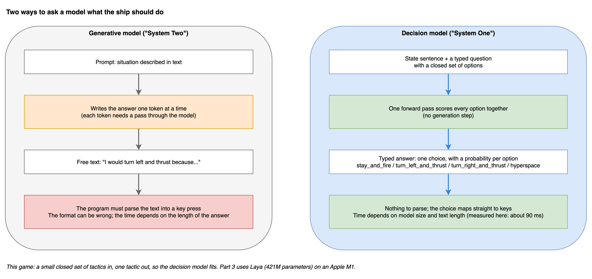
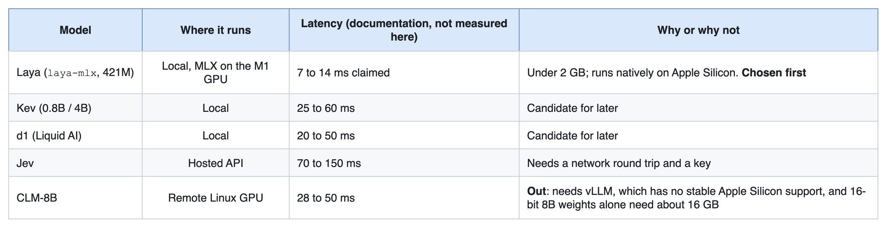
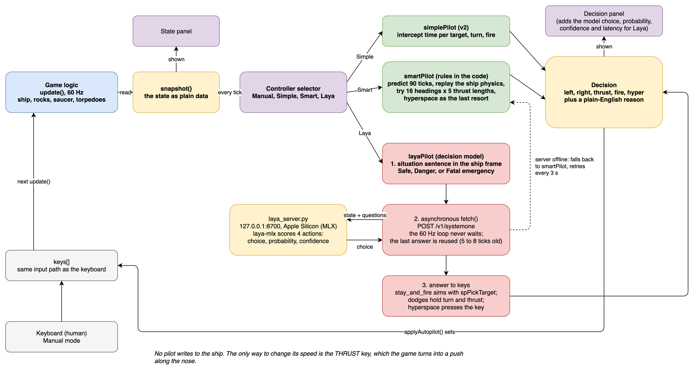
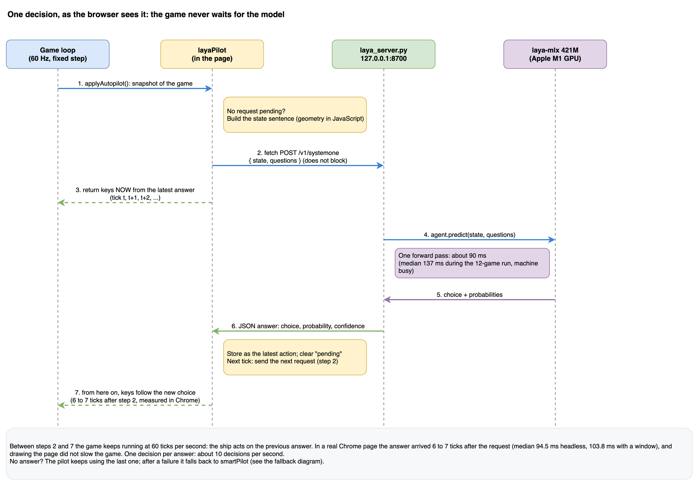
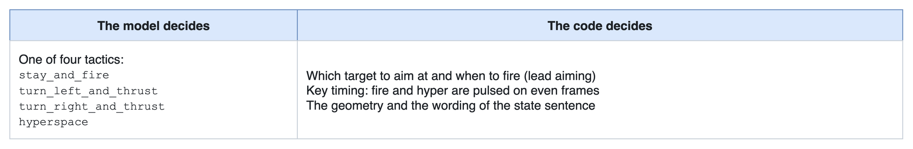
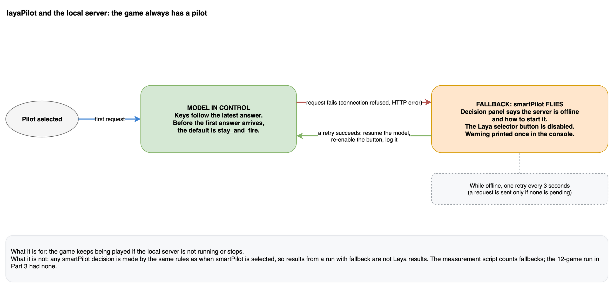
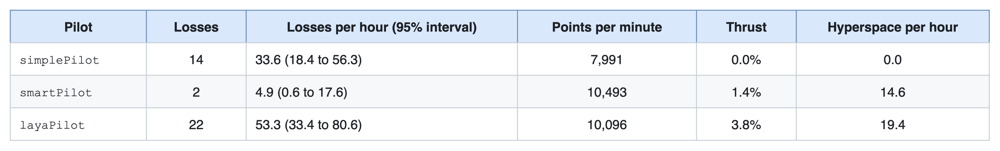
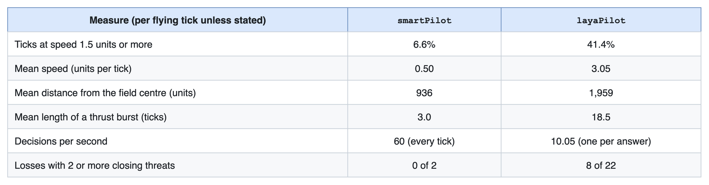
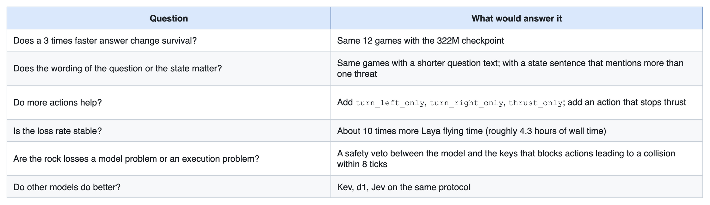

# From Rules to a Decision Model: A Model Can Fly the Ship

*Part 3 of the series "A journey in code modernization with Bob: from 6502 assembly to an AI autopilot"*

A 421M parameter decision model, running locally on a laptop and answering a typed question about the ship's situation, can fly an arcade game. In about 25 minutes of measured play per pilot it scored close to the tuned rule-based pilot from [Part 2](part-2-building-on-a-modern-base.md). It also reacted about 100 ms late, drifted around the field, and lost ships to rocks.

That is the whole claim. This article is not a verdict on rules against models. The model pilot is a first version: one model, one prompt, one question, no tuning. The rule-based pilots were tuned. What follows is how the pilot is wired, what it looks like on screen, the first numbers with their limits, and a list of what I have not tried.

---

## 1. Two Kinds of Model

A generative language model (the "System Two" kind) writes its answer token by token. It is flexible, and it is slow, free-form and sometimes wrong in format. For a control loop that runs 60 times a second, that is a poor fit.

A decision model (the "System One" kind) takes a text description and a typed question, and scores the candidate answers in a single forward pass. There is no generation step. The output is a discrete choice with a probability for each option, so there is nothing to parse and nothing to hallucinate in the format. Latency is fixed by the size of the model and the length of the text.



Editable source: [`docs/diagrams/g12-system-one-two.drawio`](../../diagrams/g12-system-one-two.drawio).

For the game, that is the right shape: a small closed set of tactics in, one tactic out.

---

## 2. Choosing a Model for a Laptop

The development machine is an Apple MacBook Air M1 with 16 GB of memory and about 16 GB of free disk. That rules some candidates out before any test.



Editable source: [`docs/diagrams/p3-model-candidates.drawio`](../../diagrams/p3-model-candidates.drawio).

The only latency I measured is Laya's, and it did not match its documentation. I come back to that in section 8.

The choice of Laya was practical, not a ranking of the models. It was the one I could run locally, today, with the least friction.

---

## 3. The `/v1/systemone` Contract

The model sits behind a small local HTTP server (`scripts/dev/laya_server.py`, about 100 lines of Python) on `127.0.0.1:8700`. The wire format is a typed request and a typed response. Abridged from what the page actually sends:

```javascript
// Snippet S7: request (from the browser) and the part of the response the pilot reads
POST /v1/systemone
{ "state": "Situation: Danger. large rock is incoming from the right on a collision path in 21 ticks. Pilot needs to turn left and thrust to dodge.",
  "questions": { "action": {
    "type": "choice",
    "instructions": "Determine the required flight action for the spaceship.",
    "criteria": {
      "stay_and_fire":         "Safe situation. Aim weapons towards target rock and fire.",
      "turn_left_and_thrust":  "Asteroid on right side. Turn left and thrust away to dodge.",
      "turn_right_and_thrust": "Asteroid on left side. Turn right and thrust away to dodge.",
      "hyperspace":            "Fatal emergency when collision is unavoidable. Hyperspace escape jump." } } } }

->  { "answers": { "action": { "choice": "turn_left_and_thrust",
                               "probabilities": { ... }, "confidence": 0.97 } } }
```

(The sentence above is an example of the format. In a recorded test of the 421M model on a state like this, the probability of the chosen option was 0.97.)

The client does not know which model is behind the endpoint, so another decision model with the same protocol could be swapped in without touching the pilot.

---

## 4. Architecture: The Game Never Waits

The game runs at a fixed 60 Hz. A model call takes several frames, so the pilot cannot wait for it.



Editable source: [`docs/diagrams/v3-pilots.drawio`](../../diagrams/v3-pilots.drawio).

The same flow as a sequence between the four parts involved:



Editable source: [`docs/diagrams/g13-browser-mlx-sequence.drawio`](../../diagrams/g13-browser-mlx-sequence.drawio).

The loop is:

1. If no request is pending, build the state sentence from the current snapshot and send it with a non-blocking `fetch`.
2. Meanwhile, every tick, turn the most recent answer into keys.
3. When the answer arrives, store it and send the next request.

So the ship always follows the latest answer, which is 5 to 8 ticks old. In a real Chrome page I measured the answer reaching the game 6 to 7 ticks after the request (median 94.5 ms headless, 103.8 ms with a window), with the game holding 60.0 ticks per second. Drawing the page does not slow the game down, so the model gets no extra game time.

---

## 5. Turning Geometry into a Sentence

The model never sees coordinates. A few lines of JavaScript compute the geometry and write one sentence in the ship's own frame. The shortest offset to each rock across the wrapping edges, its bearing relative to the nose, and its closing speed give a time to collision:

```javascript
// Snippet S8: wrap offset and time to collision (from layaFormatState, abridged)
let dx = item.x - sh.x;  if (dx > 4096) dx -= 8192; else if (dx < -4096) dx += 8192;
let dy = item.y - sh.y;  if (dy > 3072) dy -= 6144; else if (dy < -3072) dy += 6144;
const dist = Math.hypot(dx, dy);
const closing = -Math.round((dx * relVx + dy * relVy) / (dist || 1));
if (closing > 0 && dist < 1200) {
  const ttc = dist / closing;          // ticks to collision
  // keep the threat with the smallest ttc
}
```

There are three sentences the model can receive:

- **Safe** (nothing closing within 60 ticks): the ship's speed and the nearest target.
- **Danger** (collision in 60 ticks or less): which rock or saucer, from which side, in how many ticks, and which way to turn.
- **Fatal collision emergency** (8 ticks or less): ask for hyperspace.

Note what this means. The geometry is still computed by code. The sentence is built from the single threat with the lowest time to collision and says nothing about any other rock. That limit comes back in section 8.

---

## 6. Who Does What

The split of responsibility is narrow:



Editable source: [`docs/diagrams/p3-responsibility-split.drawio`](../../diagrams/p3-responsibility-split.drawio).

```javascript
// Snippet S9: from the model's choice to the keys (abridged from layaPilot)
if (choice === 'hyperspace')             { hyper = s.frame % 2 === 0; }
else if (choice === 'turn_left_and_thrust')  { left = true;  thrust = true; fire = s.frame % 2 === 0; }
else if (choice === 'turn_right_and_thrust') { right = true; thrust = true; fire = s.frame % 2 === 0; }
else { /* stay_and_fire: aim with spPickTarget and fire when aligned */ }
```

One fact matters for reading the results. In `stay_and_fire`, the Laya pilot aims with the same target picker as `smartPilot` (`spPickTarget`). So when its score comes out close to `smartPilot`'s, part of the reason is shared code, not model quality. `simplePilot` has its own, similar interception calculation.

There is also no safety check between the model and the keys. Whatever the model picks is executed. The numbers below are therefore the model's own behaviour.

---

## 7. When the Server Is Down

If the server is not running, the pilot falls back to `smartPilot`, says so in the Decision panel, and retries every 3 seconds. When the server returns, control goes back to the model without a reload. It is a small piece of code, and it means the game is never left without a pilot because a local process is not running.



Editable source: [`docs/diagrams/g15-fallback-state-machine.drawio`](../../diagrams/g15-fallback-state-machine.drawio).

<!-- CLIP V9 (could): server stopped, fallback, recovery (8 s) -->

---

## 8. What I Observed

### How it was measured

The measurement script is the one from Part 2, with the same definitions. For Laya there is one difference that must be stated. A headless run cannot let the game wait, so the script sends the real HTTP request, waits for the real answer, and applies it 6 ticks after the request (`--lag=6`). That matches what the browser does: I measured 6 to 7 ticks there.

The Laya run is short because it is slow. At about 90 ms per answer, the long run used for the rule-based pilots would take days. So all three pilots were run together on the same short budget: **12 starting points of 8,000 ticks, about 0.41 flying hours (25 minutes) each**, the same games for every pilot. Do not compare these rows with the long-run rows in Part 2.

### (a) It plays

Across the 12 starting points `layaPilot` ran with no fallback to `smartPilot` and no server error. Two further checks agree: a single seed (seed 0) at 3,000, 6,000 and 9,000 ticks, and the browser timing runs.



Editable source: [`docs/diagrams/p3-short-run-results.drawio`](../../diagrams/p3-short-run-results.drawio).

On points, in the same 12 games: `layaPilot` is ahead of `simplePilot` in 11 of 12, by 4,192 points on average in 8,000 ticks (95% interval 2,710 to 5,673). It is behind `smartPilot` by 710 points on average, but the interval (-577 to +1,997) includes zero: on points I cannot tell the two apart. Why it beats `simplePilot` I did not test. It moves, `simplePilot` never does; it shares a target picker with `smartPilot`; and it may simply stay alive longer.

### (b) It dies more than the tuned pilot

On survival the picture is less flattering. `layaPilot` lost 22 ships against 2 for `smartPilot`; an exact test on the counts gives p < 0.0001. Against `simplePilot` (14 losses) the difference is not distinguishable (p = 0.18), because the counts are small and the intervals overlap.

I will not turn that into "models lose to rules". It is two specific pilots as built: an untuned model pilot and a tuned rule set.

Two more points about the losses:

- **All 22 were rocks.** None were saucer torpedoes, none were hyperspace deaths. That is different from `smartPilot`, whose largest long-run cause was its own hyperspace.
- **They are spread out.** 10 of 12 starting points had at least one Laya loss, so the result is not one bad game.

A caution on the word "loss": no pilot ran out of ships in the short run. The game gives a free ship every 10,000 points, and at about 1.0 earned and 0.9 lost per minute, `layaPilot` sits close to break-even. By that arithmetic it could go either way over a longer run. That is a hypothesis, not a result.

### (c) What it looks like

This part is from watching it play, and then checking the numbers.

`smartPilot` moves in short taps and stays put. `layaPilot` is capable of moving out of the way of a rock it cannot destroy. Its movements look less controlled, and the ship drifts around the field for longer. Sometimes it flies into approaching rocks and has no time to react.

The behaviour counters (same 12 games) put numbers on that impression:



Editable source: [`docs/diagrams/p3-behaviour.drawio`](../../diagrams/p3-behaviour.drawio).

<!-- CHARTS C2 and C4 to generate from docs/articles/data/pilots-2026-11-10-all3-12x8000-lag6.json -->

The code explains why it drifts. `turn_left_and_thrust` holds turn and thrust for as long as the choice stays the same. There is no brake and no rule that stops thrust when the heading is right, so a dodge keeps pushing the ship after the danger has passed. It also explains why the dodge can point into a second rock: the state sentence describes only the nearest threat, and 8 of its 22 losses (36%) happened with two or more rocks closing.

Latency is not in that explanation, on purpose. I suspect the late decisions play a part, but the one experiment that would isolate it, a run with an answer within one tick (`--lag=1`), took 669 seconds for one starting point and was abandoned. One thing speaks against latency as the main cause: even an instant answer would not give the pilot an action that brakes. Whether the cause is latency, the one-threat sentence or the model itself is not known.

<!-- CLIPS: V5 smartPilot and layaPilot side by side with a ship trail (10 s); V6 Laya dodges a rock it cannot shoot (6 s); V7 Laya dodges one rock into the path of another (8 s); V8 Decision panel with choice, probability and latency (8 s) -->

### (d) The decision arrives late, and not as fast as documented

The model's own documentation states 7.4 to 13.9 ms. Measured here, one answer takes about 90 ms: 88 ms for the model call in-process, with HTTP adding a few ms. During the runs the median was 137 ms (95th percentile 156 ms), while the machine was busy with other software; idle it was 91 to 104 ms. At 60 Hz that is 5 to 8 ticks.

Where the time goes is partly known:

- It is the model's forward pass, not the network.
- The GPU is 3 to 4 times faster than the CPU, and fp16 is the fastest precision. Compiling and prompt caching did not help.
- Time grows with text length: a shorter question text brought the call from about 88 to about 66 ms.
- The smaller 322M checkpoint of the same model family answers in 27 to 35 ms, about 3 times faster.

The 7.4 ms figure was not reached (best case 26 ms), so a factor of about 3 is explained and a factor of about 12 is not. I do not know why the documentation is faster. Different checkpoint, batch setting or machine state are guesses.

---

## 9. What I Have Not Tried Yet

Each of these is a hypothesis. None has a result.



Editable source: [`docs/diagrams/p3-not-tried.drawio`](../../diagrams/p3-not-tried.drawio).

Two improvement ideas also came from watching: a rule to brake or stop thrusting after a dodge for `layaPilot`, and a return to the centre after moving for `smartPilot`.

---

## 10. Rules, Models, or Both

I started this series to see what happens when old code becomes modern code. By Part 3 the question has moved to the boundary between rules and models, and I do not have an answer.

What I can say from this one comparison:

- **Geometry and aiming look like a job for code.** The model never sees coordinates, and the pilot that shares its target picker with the rules scores about the same as the rules.
- **Choosing a tactic from a sentence looks like a job a model can do.** It did, with no fallback, over 25 minutes of play per pilot.
- **The weak points of the model pilot are visible and fixable in principle.** No brake, a one-threat sentence, a late answer. None of them is a fundamental limit that I know of.

Whether a model that chooses the tactic and code that executes it will beat a rule set that does both is the question for the next article, if the optimisations in section 9 produce results. For now, the result is the one in the title: a model can fly the ship.

---

## What This Series Showed

1. **Porting** (Part 1): an LLM translates structure well and fails on conventions the source never states. Running the code against the source found what reading did not.
2. **Building on a modern base** (Part 2): explicit state, a narrow action interface and determinism made autoplay cost lines instead of rewrites.
3. **Rules and models** (Part 3): the same interface took a decision model as easily as a rule set, and showed where each stands today.

---

### Commands to Reproduce

```bash
# Start the local decision model server (see docs/LAYA.md for setup)
.venv/bin/python scripts/dev/laya_server.py --port 8700
curl -s http://127.0.0.1:8700/health

# All three pilots, 12 starting points of 8,000 ticks, answer applied 6 ticks late (about 25 minutes)
node scripts/dev/measure_pilots.js asteroids.html 8000 simplePilot,smartPilot,layaPilot 12 --lag=6 --json=out.json

# Latency anatomy of the model call
.venv/bin/python scripts/dev/bench_laya_latency.py --calls 30 --json=out.json

# Real Chrome timing (60 s per pilot)
node scripts/dev/browser_check.js 60 simple,smart,laya --json=out.json
```

Raw output and definitions: [`docs/articles/data/`](../data/README.md). Run: 2026-11-10 and 2026-11-11, Apple MacBook Air M1 (16 GB), Node v26.3.1, `laya-mlx` 0.6.0 with `aac6fef/laya-mlx`. The Laya run is short (22 losses) and the rates are imprecise.

*Previous: [Part 2: Once the code is modern, a game becomes something a program can play](part-2-building-on-a-modern-base.md)*
