# Teaching the Model to Fly: What Fine-Tuning Changed and What It Did Not

*Part 4 of the series "A journey in code modernization with Bob: from 6502 assembly to an AI autopilot"*

A fine-tuned 421M parameter model, running on a laptop, can read the situation in an arcade game well enough to choose the same strategy as the rule-based teacher 84.3% of the time on frames it never saw in training. With the code flying the ship, it scored 10,346 points per minute in about 25 minutes of measured play, 29% more than the simple pilot from [Part 2](https://github.com/paolob67/Asteroids/blob/main/docs/articles/linkedin/part-2-building-on-a-modern-base.md). A control with no model at all, one that always chooses "aim", scored 10,502.

That control is the reason for the second half of the title. This article is about three fine-tuned models, why the first two did not fly, what I changed, and how little of the final result I can credit to the model. The pilot lost 10 ships in that time, against 22 for the first model pilot in [Part 3](https://github.com/paolob67/Asteroids/blob/main/docs/articles/linkedin/part-3-rules-to-decision-model.md) (same 12 starting points, but a different answer delay and a later build of the game, so this is a pointer and not a comparison). Whether the model is the reason is the part I could not show.

---

## 1. Why a Fourth Part

Part 3 ended with a pilot I was not happy with. With the code's verdict removed from the prompt, the model chose `stay_and_fire` 97.5% of the time and stopped dodging. With the verdict in the prompt, it was matching phrases the code had written. Neither was a model deciding.

It also ended on two untested statements: that fine-tuning might change this, and that a realistic ceiling for a model trained on logged `smartPilot` decisions was `smartPilot` itself delayed by the model's latency. This part tests both.

The aim I set was to leave the model as much autonomy as the hardware and the training data I could produce allowed. The setup:

- **Machine:** Apple MacBook Air M1, 16 GB.
- **Teacher:** `smartPilot`, the tuned rule-based pilot from Part 2. It plays, and every frame it sees is labelled with what it did.
- **Student:** Laya, the same 421M parameter decision model as Part 3, fully fine-tuned with the upstream PyTorch package on the Apple GPU (MPS), with gradient checkpointing. The `laya-mlx` port used in Part 3 serves the model but cannot train it.
- **Data:** the teacher played 20 games (seeds 100 to 119, 60,000 ticks each) for training and 5 games (seeds 200 to 204) held out. The 12 games used for measurement in Part 3 (seeds 0 to 11) are refused by the export script, so no training frame comes from a game the pilots are scored on.

The game, the frozen versions, the training files and the data behind every number below are in the repository. The numbers come from [`docs/articles/data/part4/`](https://github.com/paolob67/Asteroids/blob/main/docs/articles/data/part4/) and the test log (T12 to T20).

---

## 2. Five Ways to Split the Work

The question in every attempt is the same: which part of the decision belongs to the model, and which to the code. This table puts the two Part 3 pilots and the three students side by side.

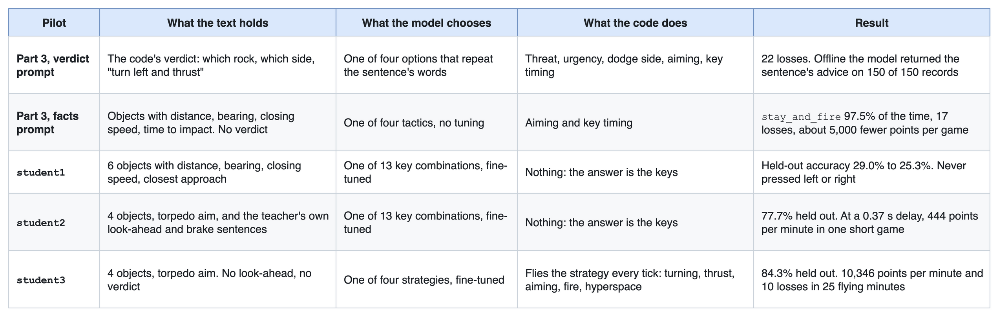

Editable source: [`docs/diagrams/p4-ladder.drawio`](https://github.com/paolob67/Asteroids/blob/main/docs/diagrams/p4-ladder.drawio).

The first two rows are Part 3. The last three are this article. The rows differ in two ways at once, the text and the question, so the table is a map and not a controlled comparison.

---

## 3. First Attempt: Keys From Facts (`student1`)

The most autonomous design asks the model for the keys. The text was a plain description of the frame in the ship's own terms: the 6 nearest objects, each with distance, bearing from the nose, closing speed and, if closing, the straight-line closest approach. The question had 13 options, each a key combination `smartPilot` really used (`none`, `left`, `right`, `thrust`, `fire`, `left_thrust`, and so on, up to `hyperspace`).

A test checks that the text states measurements only: it rejects the words "dodge", "turn ", "danger", "safe", "should" and "must" in the object list.

Training took 354 optimizer updates and 11,976 s (3.3 hours). On 1,500 held-out frames:

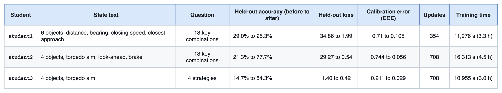

Editable source: [`docs/diagrams/p4-students.drawio`](https://github.com/paolob67/Asteroids/blob/main/docs/diagrams/p4-students.drawio).

Accuracy fell from 29.0% to 25.3%. The loss went from 34.86 down to 1.99, which is only slightly below 2.21, the loss of a predictor that knows nothing but how often each key combination occurs (random guessing is 2.56). On 300 held-out frames the model predicted only `fire`, `thrust` and `none`. It never pressed left or right.

So it did not learn the task. Why, I did not isolate. The upstream documentation says that leaving the loss plateau depends on the seed and needs a few hundred updates or more, and this run had 354. I did not run a second seed with the same text, so this section says what happened and not why.

---

## 4. Second Attempt: Put the Teacher's Computations Into the Text (`student2`)

A model cannot learn a function whose inputs are not in its text. To see how much of the teacher the text carried, I parsed the numbers back out of each sentence and trained a small classifier on them (3 layers, CPU, seconds). On the decision "turn left, turn right or none" it scored:

| Text version | Turn accuracy |
|---|---|
| Original (6 objects, closest approach) | 0.581 |
| Plus the torpedo aim for each target | 0.612 |
| Plus a look-ahead sentence | 0.793 |
| Plus a brake sentence, 4 objects (final) | 0.868 |

Always answering the most common option scores 0.324. Only the last row is in a saved file (`text-ceiling-final-text.txt`). The earlier three come from runs whose output I did not keep, so they are quoted and cannot be re-checked from the repository. This is a floor for what the text carries, not a ceiling for Laya.

The two sentences that moved the number are physics facts and contain no verdict word:

- **Look-ahead:** what hits the ship in the next 90 ticks if no key is pressed, and, if something does, the thrust length and heading that keep everything clear.
- **Brake:** if the ship drifts at 1.5 units per tick or more, the thrust that would cancel the motion and whether it is safe.

A script checks both sentences against `smartPilot` on 37,113 frames of 4 games and finds 0 disagreements.

`student2` was trained on that text: 708 updates, 16,313 s (4.5 hours). The machine was swapping up to 12.8 GB of memory during the run. Held-out accuracy went from 21.3% to 77.7%, the loss from 29.27 to 0.54, and the calibration error from 0.744 to 0.056. Thrust was read well: precision 0.98 and recall 0.94 on 600 held-out frames. Aiming was the weak part: 0.69 accuracy on the frames where the teacher just aims and fires.

**The catch.** A good number can hide that the text now contains the answer. I measured it. With the look-ahead and brake sentences a small classifier reads the teacher's strategy at 0.997, and a short string rule gets 1.000 on 6,330 of 6,330 held-out frames:

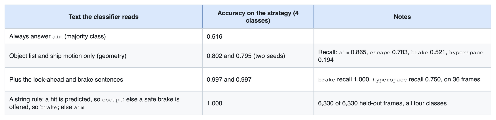

Editable source: [`docs/diagrams/p4-readability.drawio`](https://github.com/paolob67/Asteroids/blob/main/docs/diagrams/p4-readability.drawio).

The look-ahead sentence states what `smartPilot` itself computed ("with no key pressed a large rock hits the ship in 87 ticks"), so the right action follows from whether that sentence is present. The text has no verdict word, but it holds the teacher's own answer as a fact. That is the same problem as in Part 3, in a quieter form. A model trained on that text would learn to read a sentence, not to judge a situation. I come back to this in section 6.

---

## 5. Why It Still Did Not Fly

77.7% offline is not flying. I put `student2` in the game, with the same harness as Part 3: the answer is held back until a fixed number of ticks after its request, to match the server's real answer time. These are single games under a minute of flying each, an anecdote and not a measurement.

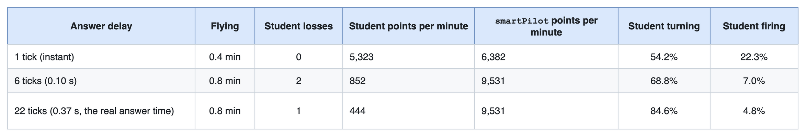

Editable source: [`docs/diagrams/p4-student2-play.drawio`](https://github.com/paolob67/Asteroids/blob/main/docs/diagrams/p4-student2-play.drawio).

With answers on the very next tick it played, at 83% of the teacher's points per minute and no loss (this model needed 0.36 to 0.49 s per answer). At its real answer time it turned 84.6% of the time, fired 4.8% and scored 444 points per minute. The `student2` checkpoint and the key-pressing pilot were removed once version 4 replaced them, so these runs can be read from the saved files but not repeated.

Was the model at fault, or the delay? I removed the model. In `measure_delayed_teacher.js`, `smartPilot` gets the same handicap: every N ticks it decides from the current frame, the keys take effect N ticks later and are held for N ticks. Four games of 8,000 ticks:

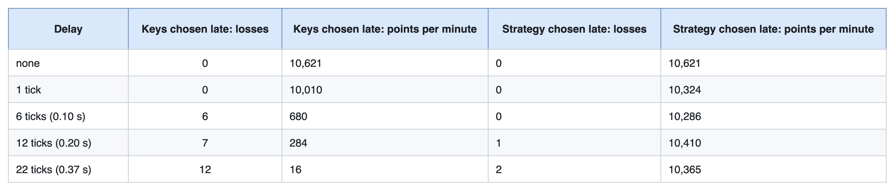

Editable source: [`docs/diagrams/p4-delay.drawio`](https://github.com/paolob67/Asteroids/blob/main/docs/diagrams/p4-delay.drawio).

The first two number columns are the teacher with held keys. With no delay it scores 10,621 points per minute and loses no ship. With a 6 tick delay (0.10 s) it loses 6 ships and scores 680, turning 84.9% of the time and firing 4.0%. At 0.37 s it scores 16.

That is the same behaviour as the student's, with no model involved, and the reason is mechanical. The ship turns 3 angle units per tick (256 units are a full turn). `smartPilot` fires only when the nose is within 3 units of the aim point. A turn key held for 6 ticks rotates the ship 18 units, so the nose overshoots before the next answer. Aiming is a feedback loop that needs a decision every tick or two. It also means the ceiling I named in Part 3, `smartPilot` delayed by the model's latency, is very low when the answer is the keys: 16 points per minute at 0.37 s.

What does survive a delay is the slow part: a dodge or a brake is a plan (turn to a heading, thrust a few times). `student2` read those well (thrust precision 0.98), and a person watching it in the browser saw it escape threats by thrusting, while it turned almost all the time and did not fire when it should.

---

## 6. The Redesign: The Model Plans, the Code Flies

If aiming needs a decision every tick and the model needs 0.4 s, the model should not aim. I split `smartPilot` without changing its behaviour (6 seeds of 20,000 ticks gave 11,842 points per minute and 4 losses before and after) into a planner and an executor, and gave the model only the plan:

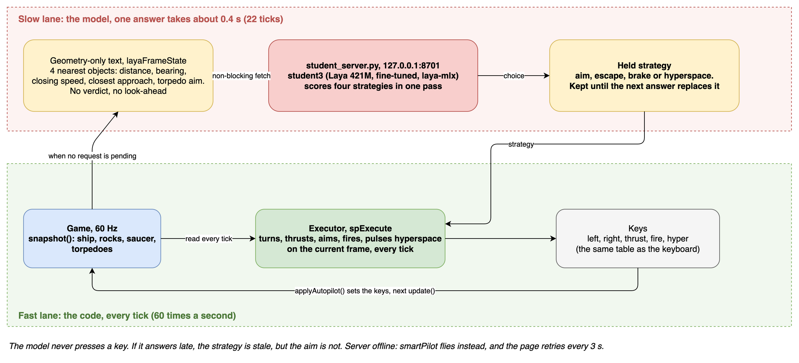

Editable source: [`docs/diagrams/p4-split-architecture.drawio`](https://github.com/paolob67/Asteroids/blob/main/docs/diagrams/p4-split-architecture.drawio).

There are four strategies:

| Strategy | What the executor does |
|---|---|
| `aim` | Turns to the quickest torpedo shot and fires. No thrust |
| `escape` | Runs the dodge search, turns to the best heading, thrusts when the nose is on it, shoots whatever is lined up |
| `brake` | Turns against the drift and thrusts while speed is 1.5 or more, shoots whatever is lined up |
| `hyperspace` | Pulses the hyperspace key on even frames |

The executor is a few lines on top of code that already existed in `smartPilot`:

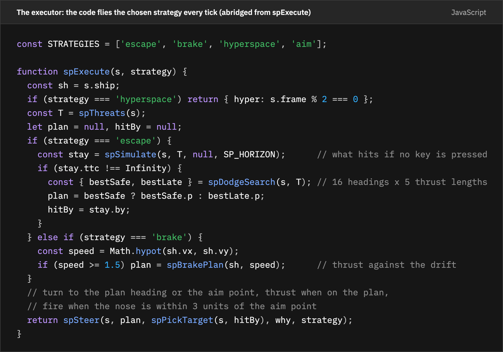

Code source: [`snippets.json`](https://github.com/paolob67/Asteroids/blob/main/docs/articles/linkedin/snippets.json) (`strategy-executor`).

**Test one, with no model: would it fly?** `measure_strategy_oracle.js` stands in for a perfect model. Every N ticks `smartPilot` names its strategy, the choice takes effect N ticks later, and the executor flies it on the current frame every tick. Same teacher, same four games, same delays as above:

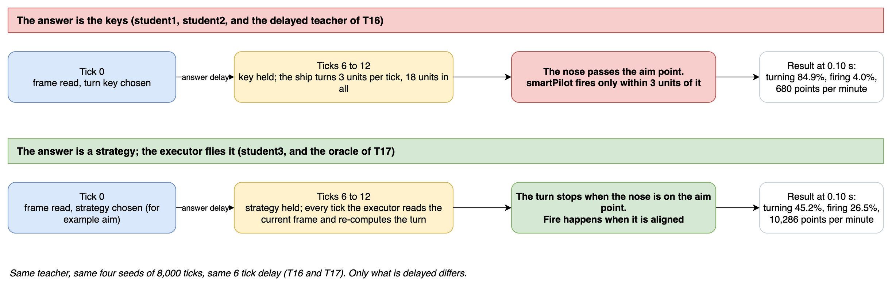

Editable source: [`docs/diagrams/p4-keys-vs-strategy.drawio`](https://github.com/paolob67/Asteroids/blob/main/docs/diagrams/p4-keys-vs-strategy.drawio).

The last two columns of the delay table above are that run. At 0.37 s the strategy chosen late scores 10,365 points per minute with 2 losses, against 16 points per minute and 12 losses with the keys chosen late. Four games of one seed each give loss counts too small to rank, and the oracle reads the answer from the teacher, so this is the best a strategy model can do, not what a model does.

**Test two, on the text: which one to train on?** The strategy labels follow from the look-ahead sentence (section 4). So I trained on geometry only: the four nearest objects with distance, bearing, closing speed, closest approach and torpedo aim, with no look-ahead and no brake sentence. From that text alone, the small classifier reads the strategy at about 0.80 (two seeds: 0.802 and 0.795), against 0.516 for always answering `aim`. I fixed this choice before training. It tests whether a model can judge the situation from what it sees, and it gives up the 0.997 that was available for free.

The request is the same typed format as in Part 3, with a state sentence and four options that say what the executor does and never when to choose it:

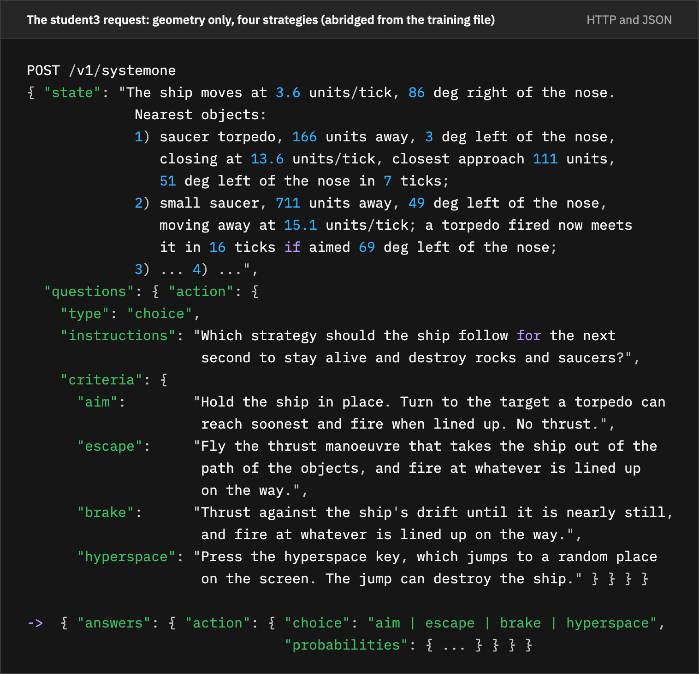

Code source: [`snippets.json`](https://github.com/paolob67/Asteroids/blob/main/docs/articles/linkedin/snippets.json) (`strategy-request`).

---

## 7. The `student3` Result

**Training.** 3,141 items, capped at 1,000 per strategy: 1,000 `aim`, 1,000 `escape`, 1,000 `brake` and 141 `hyperspace` (the teacher rarely uses it). 2,827 were used for training and 314 for calibration. The settings were those of `student2`: 2 epochs, micro-batch 2, gradient accumulation 4, soft cross-entropy, gradient checkpointing, seed 0. It took 708 updates and 10,955 s (3.0 hours). On the 1,500 held-out frames, accuracy went from 14.7% to 84.3%, the loss from 1.40 to 0.42 and the calibration error from 0.211 to 0.029.

**Offline.** On a random 600 of the held-out frames, accuracy was 0.860, against 0.548 for always answering `aim`. Per teacher strategy:

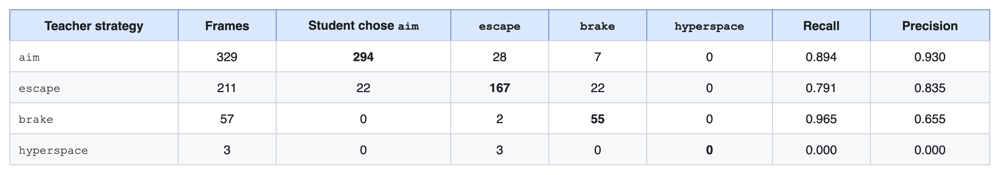

Editable source: [`docs/diagrams/p4-offline.drawio`](https://github.com/paolob67/Asteroids/blob/main/docs/diagrams/p4-offline.drawio).

On 22 of the 211 frames where the teacher escapes (10.4%) the student chose `aim`, and on 28 of the 329 frames where the teacher aims (8.5%) it chose `escape`. The 3 `hyperspace` frames were all missed, and with 3 frames nothing can be said about that class. The small classifier reached 0.80 from the same text on a larger, different frame set, so the two numbers are close but not on the same frames.

**In play.** The Part 3 protocol: seeds 0 to 11, 8,000 ticks each, all three pilots on the same games, the answer applied 22 ticks after its request (the 0.36 s the server needed on this machine). The server answered 3,879 requests with a median of 396 ms (95th percentile 590 ms), 350 of them repeats served from the harness's cache. The student never fell back to `smartPilot`.

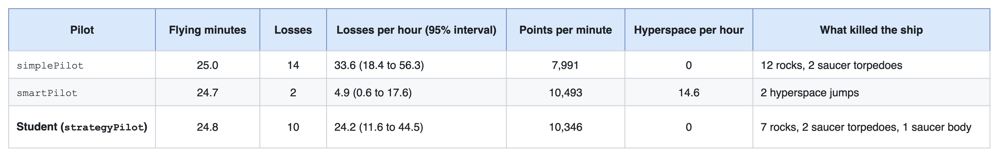

Editable source: [`docs/diagrams/p4-play.drawio`](https://github.com/paolob67/Asteroids/blob/main/docs/diagrams/p4-play.drawio).

Paired by seed (bootstrap over the 12 games, 10,000 resamples):

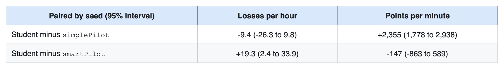

Editable source: [`docs/diagrams/p4-paired.drawio`](https://github.com/paolob67/Asteroids/blob/main/docs/diagrams/p4-paired.drawio).

What this says, and what it does not:

- **Points: the student beat `simplePilot` on 12 of 12 games**, by 2,355 points per minute on average (interval 1,778 to 2,938). Against `smartPilot` it is level within the interval (-147, from -863 to 589).
- **Losses: not a win.** 10 against 14 for `simplePilot` is a lower point estimate. It lost fewer ships on 7 games, the same on 2 and more on 3, and the interval of the difference (-26.3 to 9.8 per hour) includes zero. Before running, I had written the bar: fewer losses with points not lower. By that rule I do not call it a win.
- **Against `smartPilot` it loses more ships.** 10 against 2, and the interval of the difference (2.4 to 33.9 per hour) excludes zero.
- **The deaths:** 7 rocks, 2 saucer torpedoes and 1 saucer body. `smartPilot`'s 2 losses were both its own hyperspace jumps.
- **Time on each strategy:** `aim` 84.1%, `escape` 13.0%, `brake` 2.9%, `hyperspace` 0%.

---

## 8. What the Controls Say

A number needs something to be compared with. Here are the controls with no model, using the same executor:

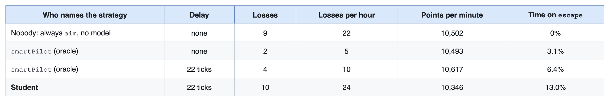

Editable source: [`docs/diagrams/p4-controls.drawio`](https://github.com/paolob67/Asteroids/blob/main/docs/diagrams/p4-controls.drawio).

- **The score does not come from the model.** A pilot that always chooses `aim` scores 10,502 points per minute, the same as the student (10,346) and well above `simplePilot` (7,991). The executor's torpedo aiming, flown every tick, is what raises the points. The same executor with a perfect plan at the same delay scores 10,617.
- **The loss count does not show a model effect either.** Always `aim` lost 9 ships, the student 10. I did not run a paired test on 9 against 10; one ship is far inside the noise.
- **The model's possible room is the gap between 9 losses (always `aim`) and 4 (the oracle at the same delay).** The student did not close any of it in this run.
- **Its mix of strategies differs from the oracle's.** It chose `escape` 13.0% of the time against 6.4% for the oracle at the same delay, and never `hyperspace`, which `smartPilot` uses 14.6 times an hour.

Why its escapes did not turn into fewer losses, I did not test. The offline numbers (10.4% missed escapes, 8.5% false alarms) show the errors are not random, but I did not check whether the missed frames are the ones that kill.

**Watching it.** I also watched it play in the browser. To my eye it behaves well, and it chose `escape` at the right moment when a rock approached. That is an observation, and the numbers above say its effect on survival is not shown.

**Clip 4 (about 40 s):** the game is played by `smartPilot` first, then switched to the Student pilot, with the Decision panel visible.

*Video file: `docs/articles/linkedin/clip-part4-gameplay.mp4`. Upload it in the LinkedIn editor here.*

---

## 9. Running It

Version 4 replaces the Laya button of Part 3 with a Student button; the selector is Manual, Simple, Smart, Student. The page probes the local server and enables the button when it answers. The pilot asks again as soon as it has an answer, keeps the last strategy, and falls back to `smartPilot` when the server is offline:

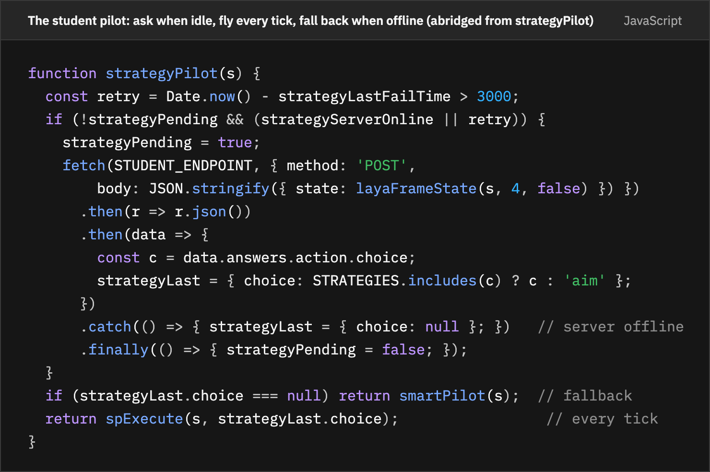

Code source: [`snippets.json`](https://github.com/paolob67/Asteroids/blob/main/docs/articles/linkedin/snippets.json) (`strategy-pilot-loop`).

The server now uses `laya-mlx`, which loads the PyTorch-trained checkpoint directly, so serving needs no PyTorch. On 200 held-out frames:

- The median answer took 184 ms (95th percentile 214 ms), against 230 to 400 ms with PyTorch on the GPU. The model loads in 1.0 s.
- It chose the same option as the PyTorch server on 200 of 200 frames (mean probability difference 0.0003).

The 12 games above ran on the PyTorch server. A smoke run of the MLX server (seeds 0 and 1, 3,000 ticks, delay 22) lost no ship and scored 9,367 points per minute, which I do not use as a result: two games, short. The full 12 games were not repeated with it.

The checkpoint (804 MB) is over GitHub's file limit, so it is a release asset, `student3.tar.gz` (778 MB, SHA-256 checked by the fetch script). The training files, the strategy data (3,141 and 1,500 rows) and a retrain recipe are in `training/student3/`. A script rebuilds the data from the game and compares it with the committed files: the output matched byte for byte. I did not run the full retrain from those files (about 3 hours, and not bit-exact on MPS), so I expect an accuracy close to 0.84 and not identical weights.

---

## 10. What It Adds Up To

- **Fine-tuning changed what the model can read.** From 14.7% to 84.3% on held-out frames, from geometry alone, with no verdict and no look-ahead. In Part 3 the same model, untrained, did not choose a tactic from facts. That part of the answer is clear.
- **A model that presses keys cannot fly at 0.37 s.** The teacher itself cannot (16 points per minute). That is a property of the loop, not of the model.
- **A model that picks the strategy can sit in the loop.** With the code flying every tick, the pilot plays at the real answer time and scores about what `smartPilot` scores.
- **I cannot say the model made it better.** Always `aim` does the same, on points and on losses. The model's room is the gap between 9 losses and the oracle's 4, and it did not close it.

What I did not do, and what would change that:

- **More frames, more epochs or a loss that weights `escape`.** One training run per student, 2 epochs, 3,141 items out of 26,105 available frames, seed 0.
- **The look-ahead text.** It would raise the strategy to about 0.997, and with it the risk of a model reading a sentence instead of the situation.
- **A student that can ask again before the delay has passed.**
- **A longer run.** 12 games give small loss counts and wide intervals.
- **The cause of `student1`'s failure, and of the weak aiming of `student2`.**

For now the answer in the title is split: the model learned to read the situation, and the code still carries the result.

---

## What This Series Showed

1. **Porting** (Part 1): an LLM translates structure well and fails on conventions the source never states. Running the code against the source found what reading did not.
2. **Building on a modern base** (Part 2): explicit state, a narrow action interface and determinism made autoplay cost lines instead of rewrites.
3. **Rules and models** (Part 3): the same interface took a decision model as easily as a rule set, and a review plus an ablation showed that the first result measured the code that wrote the prompt, not the model.
4. **Fine-tuning** (Part 4): training taught the model to read the situation, a split between a slow planner and a fast executor made it usable at its real answer time, and a control with no model showed how much of the result the executor carries.

---

### Commands to Reproduce

```bash
# Download the trained checkpoint (about 780 MB, checks the SHA-256) and start the server
bash scripts/dev/fetch_student3.sh
.venv/bin/python scripts/dev/student_server.py --ckpt .work/ckpt/student3 --port 8701
curl -s http://127.0.0.1:8701/health

# The in-play run: seeds 0 to 11, 8,000 ticks, answer applied 22 ticks late (the 12 student games took about 26 minutes of wall time)
node scripts/dev/measure_student.js 8000 0 11 --lag=22

# No model: the teacher with stale keys, and the strategy oracle at the same delays (seeds 0 to 3)
node scripts/dev/measure_delayed_teacher.js 8000 0 3 0,1,6,12,22
node scripts/dev/measure_strategy_oracle.js 8000 0 3 0,1,6,12,22

# No model: the oracle and the always-aim control on seeds 0 to 11
node scripts/dev/measure_strategy_oracle.js 8000 0 11 0,22
node scripts/dev/measure_strategy_oracle.js 8000 0 11 0 aim

# Offline check of the checkpoint on 600 held-out frames
.work/venv/bin/python scripts/dev/eval_student_offline.py .work/ckpt/student3 training/student3/val5_strategy.jsonl --n 600

# Rebuild the training data from the game and compare it with the committed files, then (optionally) retrain
bash scripts/dev/reproduce_student3.sh data
bash scripts/dev/reproduce_student3.sh train
```

Raw output and definitions: [`docs/articles/data/`](https://github.com/paolob67/Asteroids/blob/main/docs/articles/data/README.md), with the test log in [`docs/articles/TEST_LOG_PART4.md`](https://github.com/paolob67/Asteroids/blob/main/docs/articles/TEST_LOG_PART4.md). Run: 2026-11-17 to 2026-11-18, Apple MacBook Air M1 (16 GB), Node v26.3.1, `laya-mlx` 0.6.0 for serving. Training used the upstream PyTorch `laya` package at the pinned versions in `training/student3/requirements-train.txt`. The in-play run is short (12 games, 25 flying minutes per pilot, 10 student losses), so the rates are imprecise.

The game, the frozen versions 1 to 4, the measurement scripts, the training files and the raw data are all in the repository: [github.com/paolob67/Asteroids](https://github.com/paolob67/Asteroids).

*Previous: [Part 3: From rules to a decision model: who actually decides?](https://github.com/paolob67/Asteroids/blob/main/docs/articles/linkedin/part-3-rules-to-decision-model.md)*
